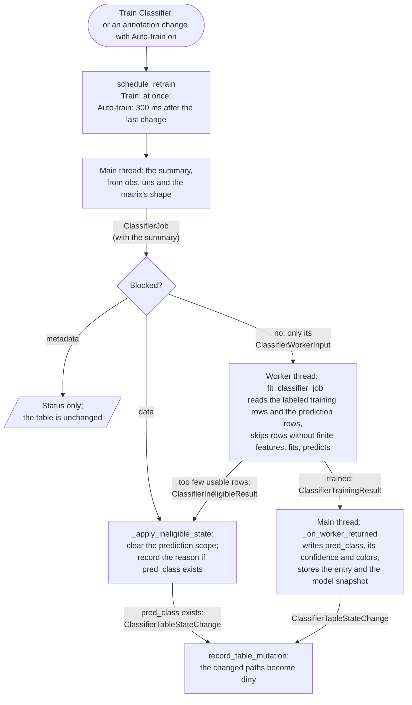
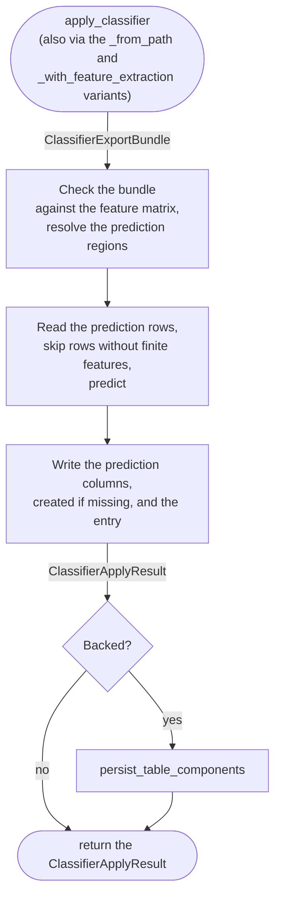

# Object classification: training, prediction and export

This document describes how Spatiato trains a classifier on the user's
annotations and predicts a class for each object, in the Object Classification
widget and in the headless API. It covers what is read and where, what is
written to the table, and how a trained model is exported and applied to other
data. It is an internal developer contract, not user documentation.

Not covered here: how objects are annotated in the viewer, how classes are
colored on the Labels layer, how features are calculated
([`feature_extraction.md`](feature_extraction.md)), and how Write and Reload
work ([`table_state.md`](table_state.md)).

## Terminology

- **User class** (`obs["user_class"]`): the annotation the classifier learns
  from. A categorical column of positive integer class ids; an unlabeled row
  is missing (`pd.NA`), never 0. Its colors are `uns["user_class_colors"]`.
  The widget writes it through `set_user_class_for_rows(...)`. Spatial Query
  writes an existing `user_class` column through its own
  `apply_spatial_annotation(...)`, and cannot create one.
- **Prediction class column:** the predicted class of each row, a categorical
  column with the same kind of class ids. The widget writes `pred_class`;
  headless `apply_classifier(...)` writes any column the caller names.
- **Confidence column:** the probability of the predicted class, a float in
  [0, 1]. Its name is derived from the class column, never chosen:
  `prediction_confidence_column(column)`, that is `f"{column}_confidence"`.
  The two columns exist together or not at all, and a row's confidence is
  missing exactly when its class is. The colors of a class column are
  `uns[f"{column}_colors"]`.
- **Feature matrix:** `obsm[feature_key]`, one row per table row, with its
  metadata record `uns["feature_matrices"][feature_key]`, whose
  `feature_columns` name the columns in order. A matrix without a valid record
  cannot be used; the widget offers to register one for a custom matrix.
- **Scope:** which labels elements, and so which table rows, take part. The
  **training scope** gives the labeled rows the model learns from; the
  **prediction scope** gives the rows that get a prediction. Each scope is
  `"selected_segmentation_only"` (the selected labels element) or `"all"`
  (every labels element the table annotates). Defaults: training `"all"`,
  prediction `"selected_segmentation_only"`.
- **Rows without finite features:** rows with a NaN or ±inf in any feature
  column, for example from a labels element whose features were not
  calculated, or a table row without an object. They are skipped: never
  trained on, and never given a prediction.
- **Eligible** (`ClassifierPreparationSummary.eligible`): nothing blocks
  training. A blocker is `"metadata"`, the feature matrix cannot be used, or
  `"data"`, the rows or labels do not allow training (see "The summary, on the
  main thread"). **Ineligible**, in this document, means a `"data"` blocker,
  found by the summary or by the worker: the predictions in the prediction
  scope are then cleared, so they never look current. A `"metadata"` blocker
  changes nothing in the table.
- **Classifier config entry** (`uns["classifier_config"][column]`): one entry
  per prediction class column, saying who last wrote that column and how.
  Whoever writes a column replaces its entry; the entries of other columns
  stay.
- **Model provenance** (`model_provenance`, in the entry and in the export
  bundle): how the model was obtained, or `None` when nothing was trained.
- **Stale** (`ClassifierController.is_dirty`): the widget's flag that its
  predictions may no longer match the current annotations, feature matrix or
  selection. Events set it, and after a reload a comparison of the stored
  entry with the selection; it can miss a change (see "When the model is
  stale").
- **Untrained:** after a reload, the table has no entry of the widget's own
  for `pred_class`: nothing was trained, or another writer, such as headless
  `apply_classifier(...)`, wrote that column last. The widget asks the user to
  train.
- **Model snapshot** (`ClassifierModelSnapshot`): the fitted estimator and its
  feature metadata, kept in memory by the widget's controller, for export. The
  table never holds an estimator.
- **Export bundle** (`ClassifierExportBundle`): a joblib file with the
  estimator, its provenance and its feature metadata, to apply the model to
  other data.

## Entry points

The widget trains and predicts in one job; headless only applies an exported
model. Both read feature values in one place,
`_read_rows_with_finite_features(...)`, and write predictions through the
same function, `_update_table_prediction_state(...)`, both in
[`src/spatiato/core/object_classification/classifier.py`](../../src/spatiato/core/object_classification/classifier.py).

**Widget.** The controller trains and predicts in one job, in a worker thread;
the main thread prepares the job and writes its result.

Train is enabled only while the summary is eligible and no job runs, so a
`"data"` blocker found by the summary reaches `_apply_ineligible_state(...)`
only through Auto-train. Through Train, only the worker can find the inputs
ineligible. A `"metadata"` blocker never reaches it: `schedule_retrain(...)`
stops on it.

**Headless.** `apply_classifier(...)` in `spatiato.headless` applies an
exported model in the caller's thread, and writes to the store itself when the
SpatialData is backed. It wraps the core `apply_classifier(...)` in
`classifier.py`, which changes only the table in memory.

## The summary, on the main thread

`ClassifierController._prepare_classifier_summary()` runs on every refresh of
the widget, so it reads no feature values: the column count comes from the
matrix's shape (`feature_matrix_n_features(...)`). A lazy or backed matrix stays
unread. It resolves both scopes to labels elements and table row positions
(`_resolve_classifier_scopes(...)`), counts the labeled rows of the training
scope and their classes from `obs`, and returns a
`ClassifierPreparationSummary`.

A blocker has a kind:

- **`"metadata"`:** the feature matrix or its metadata record is missing or
  invalid, or the two do not match (`inspect_feature_matrix_metadata(...)`).
  Nothing changes; the status says what to do, for example to register the
  matrix. A matrix without columns always ends here: a valid record names at
  least one column, and a record whose width differs from the matrix's does
  not match it.
- **`"data"`:** the inputs do not allow training: the prediction scope has no
  table rows, or the training scope has fewer than 2 labeled rows or fewer
  than 2 classes. A training request then clears the prediction scope, and
  records the reason when `pred_class` exists. No feature key chosen is also
  a `"data"` blocker, but then Train is disabled and `schedule_retrain(...)`
  stops before the summary, so nothing is cleared.

The summary counts every labeled row, also those without finite features. The
worker checks the same minimums again with the rows it can use, so the
`n_training_labels` and `class_labels_seen` it reports can be lower than the
summary's counts.

## The worker

`ClassifierWorkerInput.from_summary(...)` derives, on the main thread and from
`obs` only, what the worker reads: the matrix object as attached (NumPy,
SciPy, Dask or a backed handle, not a copy), the positions of the labeled rows
of the training scope with their classes, the positions of the prediction
scope's rows, and the region of each row. The worker
(`_fit_classifier_job(...)`):

1. reads the labeled training rows through
   `_read_rows_with_finite_features(...)`, which reads them with
   `read_matrix_rows(...)` and drops the rows without finite features. For a
   lazy or backed matrix, only the stored chunks or blocks that contain a
   requested row are read, and a backed CSC matrix is read whole; only the
   requested rows are returned. An unlabeled row is requested only to be
   predicted;
2. returns `ClassifierIneligibleResult` when fewer than 2 rows or 2 classes
   remain, naming the labels elements whose rows it all skipped;
3. reads the prediction rows the same way, and returns
   `ClassifierIneligibleResult` when none has finite features;
4. fits a `RandomForestClassifier` (`n_estimators=100`, `random_state=0`,
   `n_jobs=-2`) and predicts with one call to `predict_proba(...)`: the class
   with the highest probability, and that probability as the confidence
   (`_predict_classes_and_confidences(...)`);
5. returns `ClassifierTrainingResult`: the predicted rows, classes and
   confidences, the counts of skipped rows, the labels elements without
   features, and the estimator.

Every job has an id. A new request, `mark_dirty(...)`, a selection change, a
reload and a Feature Extraction overwrite all invalidate the running job: its
result arrives on the main thread and is ignored
(`_is_current_job(...)`). A running fit cannot be interrupted; it only stops
mattering.

Accepted on purpose: the worker may read the matrix while Feature Extraction
rewrites the same key. If the job is still running when Feature Extraction
ends, the `updated` event discards its result. If it finished first, its
predictions stay, and the model is marked stale. If the read fails, the status
shows the error, and the table stays as it was. The reasons are in the
docstring of `ClassifierWorkerInput`.

## When the model is stale

`ClassifierController.is_dirty` marks the model stale. The flag by itself
changes nothing in the table: the predictions stay as they are, the Train
tooltip says the model is stale, and Export is unavailable. An ineligible
result also marks the model stale, but it clears the prediction scope as well.

The status shows "model is stale because …" when the change gives a reason,
and "model is stale. Click Train Classifier to refresh predictions." when it
does not. A scheduled retrain, a failed job, an ineligible result, an
untrained table after a reload and a reloaded entry without a model each show
their own message instead.

The model becomes stale when:

- the annotations change, in this widget or through Spatial Query;
- the labels element, the coordinate system, the table, the feature key, the
  training scope or the prediction scope changes while a valid table is bound,
  because the user changed it in the widget or because a Feature Extraction
  event changed which table or key is selected (`bind(...)` reports the
  change, then `mark_dirty(...)` records it with its reason);
- feature metadata is registered for a custom matrix;
- Feature Extraction overwrites the selected feature key
  (`invalidate_for_feature_matrix_overwrite(...)`);
- training is requested, until its result arrives (`schedule_retrain(...)`;
  Train calls `mark_dirty(...)` first);
- a job fails, or the inputs turn out to be ineligible;
- after a reload, the table has no entry of the widget's own for
  `pred_class`; that entry does not match the selected feature key,
  prediction scope, labels element or training scope, or the matrix's current
  width (`_reloaded_model_mismatches(...)`); or it has no `model_provenance`,
  because nothing was trained.

It becomes current again only when a job's result is written
(`_on_worker_returned(...)`), or after a reload: `reset_after_reload()` clears
the flag, and sets it again only for the cases of the last bullet.
`mark_dirty(...)` also discards the running job. Only an annotation change
schedules a retrain, and only with Auto-train on; every other change waits
for Train.

A reload can miss a change: the entry does not record which labels or feature
columns the model was trained on, or the matrix's values. So an entry written
before later annotations, or for a matrix recalculated since with the same
width, counts as current after a reload. Recording the labels and the columns
is tracked in
[vibspatial/spatiato#133](https://github.com/vibspatial/spatiato/issues/133).

## What is written to the table

`_update_table_prediction_state(...)` writes the predictions, for the widget
and for headless alike:

1. every row of the prediction scope is cleared first, class and confidence,
   so an old prediction cannot survive on a row whose features are now invalid;
2. the rows with finite features get their class and confidence;
3. a class id the column did not have yet is added as a category; existing
   categories are kept;
4. the colors are derived again: a class id that is also a user class gets the
   user class's color, any other a default color per id
   (`_derive_prediction_palette(...)`). The stored prediction colors are never
   used as a source.

Missing columns are created; a column, or the colors, is written only when it
changes. The result, `PredictionStateChange`, says which changed. Clearing for
an ineligible result (`_clear_predictions_for_row_positions(...)`) never
creates the columns: without them there is nothing to clear.

The classifier config entry (`build_classifier_config_entry(...)`) holds:

| Field | Widget | Headless `apply_classifier(...)` |
| --- | --- | --- |
| `source` | `"widget"` | `"apply_classifier"` |
| `pred_class_column`, `pred_confidence_column` | `pred_class`, `pred_class_confidence` | the caller's column and its derived confidence column |
| `feature_key` | the selected key | the key it applied to |
| `prediction_regions` | the labels elements of the prediction scope | the requested labels elements, or every one of the table |
| `prediction_timestamp` | when it was trained, or when it was found ineligible | when it was applied |
| `prediction_scope` | the prediction scope's mode | `None` |
| `classifier_path` | `None` | the bundle's file, if given |
| `reason` | why nothing was trained, or `None` | `None` |
| `model_provenance` | built from the job (`_build_model_provenance(...)`), or `None` when nothing was trained | the bundle's |

`model_provenance` has nine fields: `feature_key` (the key the model was
trained on), `model_type`, `rf_params`, `training_scope`, `training_regions`,
`n_features`, `training_timestamp`, `n_training_labels` and
`class_labels_seen`. The prediction counts are not stored: the class column
holds them.

The widget writes an entry for an ineligible result only when `pred_class`
exists: without that column, nothing was cleared, and there is no column to
describe. A failed job writes nothing. Headless has no ineligible result: when
no row has finite features, it still creates the columns if they are missing,
clears the scope, and writes its entry.

The widget records every change as a mutation (`record_table_mutation(...)`),
so its paths become dirty until Write: `uns["classifier_config"]` always, and
`obs["pred_class"]`, `obs["pred_class_confidence"]` and
`uns["pred_class_colors"]` when they changed. The event's regions are the
prediction scope's labels elements, and its source is
`"object_classification_inference"`. An annotation is recorded the same way,
with `obs["user_class"]` and `uns["user_class_colors"]`, and source
`"object_classification_annotation"`.

Headless is not connected to the widget's app state. On backed SpatialData it
writes through `persist_table_components(...)`
(`_write_backed_prediction_state_if_needed(...)`): one `obs` path, which
writes the whole `obs`, and the `uns` keys `user_class_colors`, the class
column's colors and `classifier_config`, each only when it exists in memory.
So unsaved changes in the same SpatialData object reach the store too: every
unsaved `obs` change, and unsaved changes to those three `uns` keys, such as
the widget's own `classifier_config` entry. As after any Write, the table's
`obs` and `uns` are then new objects, read back from the store (see
[`table_state.md`](table_state.md)).

## The table's state when it is bound

Before the widget binds a table, `validate_object_classification_table_state(...)`
checks the existing `user_class`, `pred_class` and `pred_class_confidence`
columns, without changing them: categorical columns with positive integer
categories, both prediction columns present or both absent, a floating-point
confidence in [0, 1], missing exactly where the class is. A table that fails is
not bound: the status card says why, the Labels layer gets neutral styling, and
nothing is written. Missing columns stay missing until an annotation or a
prediction creates them.

## Interaction with other workflows

- **Annotations:** a change to `user_class`, from this widget or from Spatial
  Query, marks the model stale (`mark_dirty(...)`) and, with Auto-train on,
  schedules a retrain.
- **Selection:** a change of labels element, coordinate system, table,
  feature key or scope cancels the running job, drops the model snapshot
  (`bind(...)`) and marks the model stale, whether the user made it in the
  widget or a Feature Extraction event did (see "When the model is stale").
- **Feature Extraction:** an `updated` event for the selected key on the
  selected table calls `invalidate_for_feature_matrix_overwrite(...)`: the
  running job is discarded, the model is stale, and the snapshot is dropped.
  The widget does not retrain by itself. An event that changes which table or
  key is selected, for example a first matrix on the selected table, rebinds
  instead (`_bind_current_selection(...)`), with "the annotation table
  changed" or "the feature matrix changed" as the reason.
- **Reload:** before a reload, `prepare_for_table_reload(...)` calls
  `freeze_for_reload()`, which discards the running job and the snapshot.
  Classifier jobs only calculate, so they never make the table busy, and a
  reload does not wait for them. After the reload
  (`_adopt_reloaded_table_state(...)`), `reset_after_reload()` reads the
  widget's own entry of `pred_class` (`source == "widget"`):
  - no such entry, because nothing was trained or another writer wrote the
    column last: untrained and stale, "Click Train Classifier to train one";
  - an entry for another feature key, prediction scope or training scope, one
    that does not cover the selected labels element, or one whose
    `model_provenance` names another feature count than the matrix has:
    stale, with the mismatch;
  - an entry with `model_provenance`: the predictions are current, counted from
    the table; Export stays unavailable until the next training, since the
    estimator is not in the table;
  - an entry without `model_provenance`, which records that nothing was
    trained: stale, with its `reason`.

  Only these fields are compared (see "When the model is stale").
- **Headless on the same SpatialData:** the widget is not notified. Backed,
  headless writes to the store, and a Reload shows the new predictions; after
  a headless apply on `pred_class`, the widget is untrained, since the entry's
  `source` is `"apply_classifier"`. Unbacked, there is no store to reload
  from: the table already holds the new predictions, but the Labels layer is
  not restyled until another change refreshes it, and the widget still
  reports, and can export, its own model.

## Export and apply

Export (`ClassifierController.export_classifier(...)`, checked by
`_validate_export_ready()`) requires a model that is current: no job running,
not stale, a snapshot for the selected feature key, and feature metadata that
still matches the snapshot and the matrix's width. The snapshot is stored
only when, right after training, the feature metadata still matches the
matrix's width (`_store_model_snapshot(...)`). Otherwise Export is
unavailable, with that reason, although the model is current.

The bundle (`build_classifier_export_bundle(...)`, a `ClassifierExportBundle`)
holds:

- `schema_version` (2);
- `created_at`, `spatiato_version` and `sklearn_version`;
- `estimator`, the fitted `RandomForestClassifier`;
- `model_provenance`, as in the widget's entry;
- `source_feature_metadata`, the training matrix's metadata record: its
  `feature_columns`, and how the features were calculated, including
  `source_channels`.

The file (`write_classifier_export_bundle(...)`) also holds `bundle_type`
(`"spatiato_classifier"`), which is not a field of the bundle. It is written
with `joblib`, which uses pickle: only load bundles from trusted sources.
`read_classifier_export_bundle(...)` checks the bundle type, then the schema
version, before any other field; then the fields, the estimator type, the
model type in `model_provenance`, the source kind, that there is at least one
feature column, and that the estimator's feature count matches
`feature_columns`. There is no migration from older schema versions.

Headless `apply_classifier(...)` checks, before it reads any value:

- the target matrix and its metadata record exist
  (`_validate_feature_matrix_compatible_with_bundle(...)`);
- its `feature_columns` equal the bundle's, in the same order. The source kind
  may differ: a model trained on a harpy matrix applies to a custom matrix
  with the same columns. Equal widths are not enough: the estimator must get
  the same feature in each column;
- the matrix's width matches its `feature_columns`, and the estimator's
  feature count matches that width
  (`_validate_estimator_matches_feature_matrix(...)`);
- every requested labels element is annotated by the table, so a typo fails
  instead of being skipped (`_resolve_prediction_regions(...)`). Without
  `prediction_regions`, every labels element of the table is predicted.

The columns it writes, and `user_class`, are checked only when it writes,
after the rows are read and predicted: the class column must be categorical
with positive integer categories, the two prediction columns must exist
together, the confidence column must be floating point, and `user_class`, if
present, must be valid to derive the colors from. Unlike the widget's check
before binding, the confidence range and the missing values are not checked.

`apply_classifier_with_feature_extraction(...)` first calculates the matrix
with `compute_features_for_classifier(...)`, with the bundle's feature names
and, for intensity features, its `source_channels`, then applies the model to
the labels elements it calculated. A bundle trained on a custom matrix cannot
calculate its features this way.

## Errors and outcomes

| Situation | Found by | Table changed? | Widget | Headless |
| --- | --- | --- | --- | --- |
| Invalid class or prediction columns | `validate_object_classification_table_state`, before binding; headless: `_update_table_prediction_state` and `_derive_prediction_palette`, after reading and predicting | no | table not bound, status card | exception, for `user_class` and the columns it writes; the confidence range and missing values are not checked |
| Feature matrix or its metadata record missing, invalid or mismatched, also a matrix without columns | the summary (`"metadata"`); headless: `_validate_feature_matrix_compatible_with_bundle` | no | Train disabled, status | exception |
| No table rows in the prediction scope, fewer than 2 labeled rows or 2 classes | the summary (`"data"`) | Auto-train: prediction scope cleared; reason recorded if `pred_class` exists | Train disabled, status | – |
| Fewer than 2 labeled rows or 2 classes after skipping rows without finite features | the worker | prediction scope cleared; reason recorded if `pred_class` exists | status | – |
| No prediction row with finite features | the worker; headless: `apply_classifier` | prediction scope cleared; widget: reason recorded if `pred_class` exists; headless: columns created if missing, entry written | status | no prediction; the rows are counted as skipped in the result |
| Error while reading, training (widget) or predicting (headless) | the worker; headless: `apply_classifier` | no | "training failed: …", stale | exception |
| Bundle columns or width do not match the matrix | `_validate_feature_matrix_compatible_with_bundle` | no | – | exception |
| Estimator's feature count does not match the matrix | `_validate_estimator_matches_feature_matrix` | no | – | exception |
| Unknown prediction region | `_resolve_prediction_regions` | no | – | exception |
| Unsupported or damaged bundle | `read_classifier_export_bundle` | no | – | exception |
| Export of a stale, running or missing model | `_validate_export_ready` | no | Export disabled, tooltip with the reason | – |
| Export file cannot be written | `write_classifier_export_bundle`; reported by `_export_classifier` | no | "Classifier Export Error" with the error | – |

## Where to find it

- Core: `apply_classifier`, `build_classifier_config_entry`,
  `store_classifier_config_entry`, `get_classifier_config_entry`,
  `prediction_confidence_column`, `validate_object_classification_table_state`,
  `_validate_feature_matrix_compatible_with_bundle`,
  `_validate_estimator_matches_feature_matrix`, `_resolve_prediction_regions`,
  `_read_rows_with_finite_features`, `_update_table_prediction_state`,
  `_clear_predictions_for_row_positions` and `_derive_prediction_palette` in
  [`src/spatiato/core/object_classification/classifier.py`](../../src/spatiato/core/object_classification/classifier.py).
- User class: `set_user_class_for_rows` in
  [`src/spatiato/core/object_classification/annotation.py`](../../src/spatiato/core/object_classification/annotation.py);
  Spatial Query's `apply_spatial_annotation` in
  [`src/spatiato/core/spatial_query/annotation.py`](../../src/spatiato/core/spatial_query/annotation.py).
- Export bundle: `ClassifierExportBundle`, `ClassifierModelSnapshot`,
  `build_classifier_export_bundle`, `write_classifier_export_bundle` and
  `read_classifier_export_bundle` in
  [`src/spatiato/core/object_classification/classifier_export.py`](../../src/spatiato/core/object_classification/classifier_export.py).
- Row reads: `read_matrix_rows` in
  [`src/spatiato/core/table_matrix.py`](../../src/spatiato/core/table_matrix.py).
- Controller: `ClassifierController` (`bind`, `mark_dirty`,
  `schedule_retrain`, `_prepare_classifier_summary`, `_launch_retrain_job`,
  `_on_worker_returned`, `_apply_ineligible_state`, `_store_model_snapshot`,
  `freeze_for_reload`, `reset_after_reload`,
  `_update_status_from_reloaded_table`, `_reloaded_model_mismatches`,
  `invalidate_for_feature_matrix_overwrite`, `export_classifier`,
  `_validate_export_ready`), the job's data classes, `_fit_classifier_job` and
  `_build_model_provenance` in
  [`src/spatiato/widgets/object_classification/controller.py`](../../src/spatiato/widgets/object_classification/controller.py).
- Widget: `_retrain_classifier`, `_export_classifier`,
  `_on_annotation_changed`, `_on_classifier_table_state_changed`,
  `_on_table_state_changed`, `_consume_spatial_query_annotation`,
  `prepare_for_table_reload`, `_adopt_reloaded_table_state` and
  `_bind_current_selection` in
  [`src/spatiato/widgets/object_classification/widget.py`](../../src/spatiato/widgets/object_classification/widget.py).
- Headless: `load_classifier`, `apply_classifier`,
  `apply_classifier_with_feature_extraction`, their `_from_path` variants,
  `compute_features_for_classifier` and
  `_write_backed_prediction_state_if_needed` in
  [`src/spatiato/headless.py`](../../src/spatiato/headless.py).
