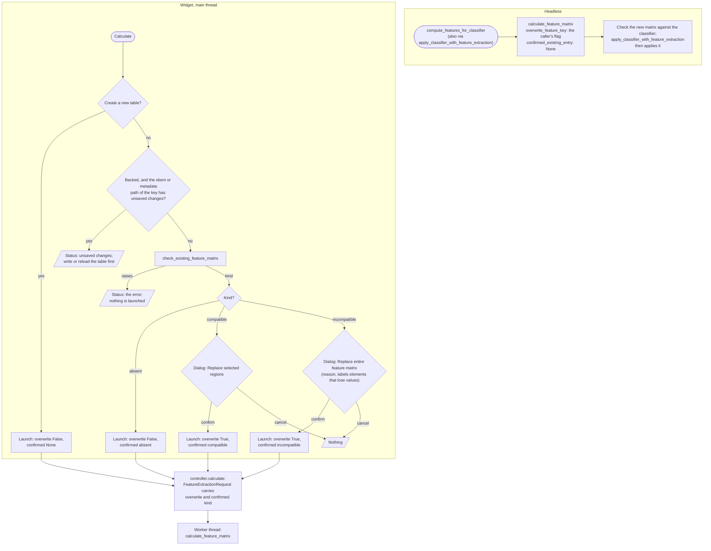
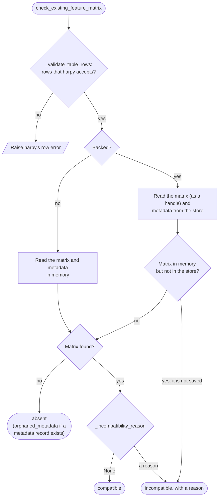
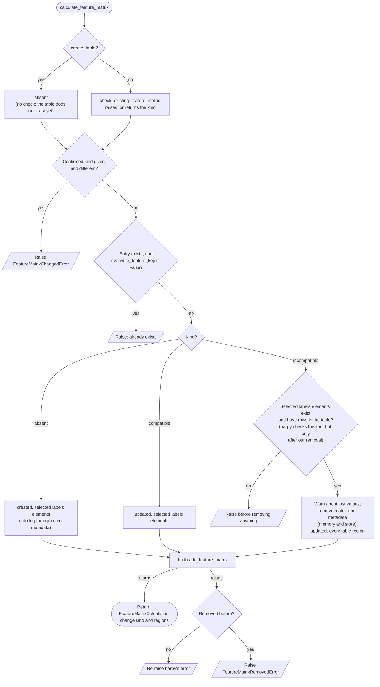
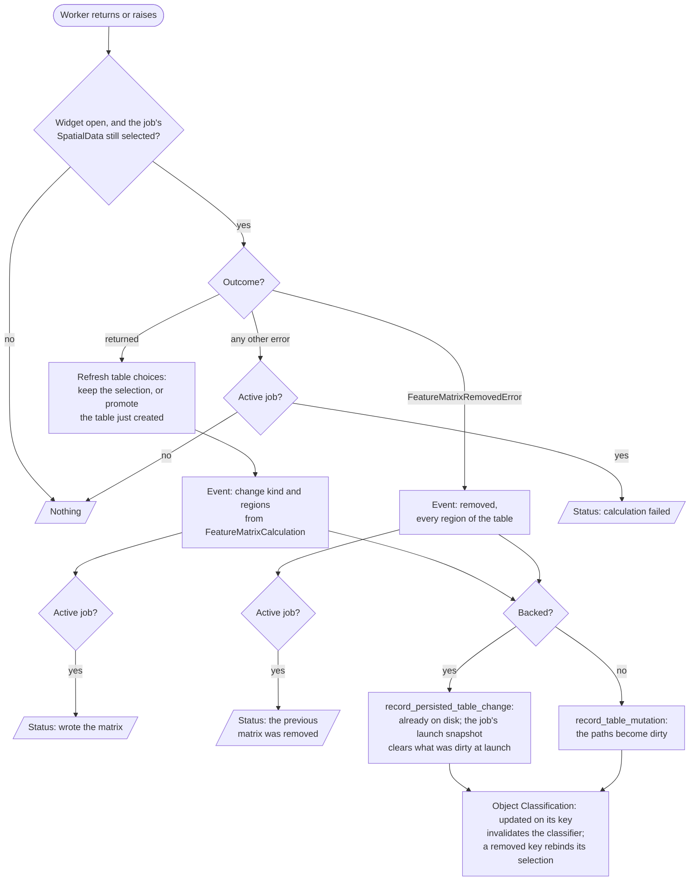

# Feature extraction into an existing feature key

This document describes how Spatiato calculates a feature matrix with
`hp.tb.add_feature_matrix(...)`, in particular when `obsm[feature_key]` already
exists. It covers who decides what, what is rejected, and how memory and store
relate. It is an internal developer contract, not user documentation.

> The decisions behind this flow, and their reasons, are recorded in P7 of
> [`Roadmap/bump_harpy/bump_harpy.md`](../../Roadmap/bump_harpy/bump_harpy.md).

## Terminology

- **Feature matrix entry:** `table.obsm[feature_key]` together with its metadata
  record `table.uns["feature_matrices"][feature_key]`.
- **Kind of the existing entry** (`ExistingFeatureMatrixKind`):
  - **absent:** there is no matrix. Extraction creates one; nothing is lost.
  - **compatible:** harpy accepts the matrix for a regional update.
  - **incompatible:** anything else, with a reason. The matrix is replaced
    entirely.
- **Regional update:** harpy replaces the rows of the selected labels elements
  and keeps the rows of the other labels elements. This is what harpy does with
  an existing matrix since 0.5.0.
- **Full replacement:** Spatiato removes the matrix and its metadata, then harpy
  calculates a fresh matrix. Rows of the labels elements that were not selected
  become NaN, so their values are lost.
- **Orphaned metadata:** a metadata record without a matrix. It counts as
  absent; the record is replaced.
- **Confirmed kind** (`confirmed_existing_entry`): the kind the caller found
  before launching. The core checks again and stops if the kind changed.
- **Backed:** `sdata.path` is set, so the table also lives in a Zarr store.
  **Unbacked:** the table exists only in memory.
- **Promotion:** after a job created a new table (create-table mode, "Create
  table..." in the Table drop-down), the widget switches its selection from
  "create `<table>`" to the existing `<table>`. The next Calculate then updates
  that table instead of trying to create it again.
- **Active job:** the running job while the current selection is the one it
  was launched for. Changing an input (a feature, the key, the table) detaches
  it: it is no longer active, but its harpy call cannot be interrupted and runs
  to completion. Changing the input back makes it active again, and promotion
  does not detach it: the selection is still that job's, now as an existing
  table. Calculate stays disabled until the
  job has finished writing, because harpy does not protect concurrent writers
  to one store, so a widget has at most one job. Nothing is queued: the user
  clicks Calculate again afterwards.

## Entry points

Both entry points end in one shared function,
`calculate_feature_matrix(...)` in
[`src/spatiato/core/feature_extraction.py`](../../src/spatiato/core/feature_extraction.py).
The widget checks the existing entry on the main thread to pick a dialog, and
the core checks again in the worker. Headless has no dialog and acts on what
the core finds.

The unsaved-changes block runs only on the main thread, at launch: dirty state
lives in `SpatiatoAppState`, so the widget passes the table's dirty paths to the
controller's `check_existing_feature_matrix(...)`, which applies the block. The
worker's re-check does not repeat it; a change made between launch and the
re-check is not caught (accepted).

## Classification in `check_existing_feature_matrix`

`check_existing_feature_matrix(...)` classifies the existing entry without
changing anything. The widget calls it on the main thread to pick a dialog,
and `calculate_feature_matrix(...)` calls it again in the worker. It
raises when no update can succeed: rows that harpy would reject, an unknown
channel or a missing image, or a backed table that is not in the store.

- **Row validation comes first, for every kind.** harpy rejects any feature
  update of a table whose rows are invalid or, when backed, differ from the
  store. `remove_table_components(...)` does not check rows, so without this an
  incompatible entry would be removed before harpy's rejection.
- **The check reads what harpy will merge against.** For backed SpatialData,
  harpy reads the existing entry from the store, so the check does too. Memory
  is only used to detect a matrix that was never saved.

Reasons for an incompatible entry, in the order they are checked:

| Reason                                                   | Cause                                                                   |
| -------------------------------------------------------- | ----------------------------------------------------------------------- |
| it is not saved                                          | backed: the matrix is in memory but not in the store                    |
| it has no harpy feature metadata                         | no metadata record for the key                                          |
| it is registered as a custom matrix                      | `source_kind` is Spatiato's custom `obsm` kind                          |
| its metadata does not come from harpy feature extraction | any other `source_kind`                                                 |
| its metadata has an unsupported schema version           | `schema_version` differs                                                |
| it was calculated with different features or channels    | `feature_columns` differ from the request                               |
| it was calculated from different channels                | `source_channels` differ from the request                               |
| it is not a dense matrix                                 | sparse, DataFrame or another type                                       |
| its shape ... does not match ...                         | not `(n_obs, number of feature columns)`                                |
| its dtype ... cannot hold float64 values                 | dtype cannot hold float64 safely                                        |

All reasons except the first come from `_incompatibility_reason(...)`.

## Decisions in `calculate_feature_matrix`

`calculate_feature_matrix(...)` runs the check, applies the rules below, and
only then removes or calculates. Every rejection before the harpy call leaves
the table unchanged.

- **The overwrite rule is Spatiato's.** harpy only requires
  `overwrite_feature_key` for entries in the store. Spatiato requires it for an
  existing entry in both storage modes, so headless behaves the same unbacked
  and backed. Spatiato itself always passes `overwrite_feature_key=True` to
  harpy for an existing table, because the entry was checked already, and
  harpy needs the flag for orphaned metadata in the store.
- **Labels elements are validated before the removal**, because harpy would
  reject them only after it.
- **Removal plus extraction is not atomic.** If harpy fails after the removal,
  the old matrix is gone. `FeatureMatrixRemovedError` records that, with every
  region of the table.

## Memory versus store

| Situation                                              | Unbacked                                   | Backed                                                                                   |
| ------------------------------------------------------ | ------------------------------------------ | ---------------------------------------------------------------------------------------- |
| Where the existing entry is read                       | memory                                     | store, as a handle without loading values                                                |
| No matrix                                              | absent                                     | absent: none in the store and none in memory                                             |
| Metadata without a matrix                              | absent, orphaned metadata replaced         | the same, for metadata in the store or in memory                                         |
| Matrix only in memory (never saved)                    | –                                          | incompatible, "it is not saved": full replacement                                        |
| Matrix only in the store (changed outside Spatiato)    | –                                          | the stored entry is checked; a regional update brings its other rows back into memory    |
| Unsaved changes to a stored entry, tracked by Spatiato | –                                          | widget: blocked at launch; headless: the store wins                                      |
| Changes Spatiato does not track (notebook, other process) | –                                       | the store wins silently (accepted, as in harpy)                                          |
| Rows invalid, or differ between memory and store       | invalid rows: raise before any change      | raise before any change                                                                  |
| Where the result lands                                 | memory; the widget marks the paths dirty   | store and memory; already persisted                                                      |

## After the worker

The worker returns the `FeatureMatrixCalculation` of the core, or raises. The
controller decides what to publish. Jobs that are no longer active still
publish their table change, because the harpy call cannot be interrupted and
still writes. A returned job also refreshes the widget's table choices, since it
may have created a table. The current selection is kept, unless the created
table is still the create-table target: then it is promoted to an existing
table.

Every event uses the paths `obsm/<feature_key>` and
`uns/feature_matrices/<feature_key>`, with `source="feature_extraction"`. A full
replacement is published as `updated` rather than `rebuilt`, because Object
Classification only invalidates its classifier on `updated`.

## Errors and outcomes

| Error                                                   | Raised by                                          | Table changed? | Widget                                            | Headless   |
| ------------------------------------------------------- | -------------------------------------------------- | -------------- | ------------------------------------------------- | ---------- |
| Unsaved changes to the key (backed)                     | widget, before the check                           | no             | status, nothing launched                          | –          |
| Rows harpy would reject                                 | `_validate_table_rows`, in the check               | no             | main thread: status; worker: status               | exception  |
| Unknown channel, missing image                          | channel resolution, in the check                   | no             | the same                                          | exception  |
| Backed table not in the store                           | the check                                          | no             | the same                                          | exception  |
| `FeatureMatrixChangedError`                             | the re-check, kind differs from the confirmed kind | no             | status (active job)                               | –          |
| Already exists                                          | `overwrite_feature_key=False` with an entry        | no             | not reached: the widget passes the confirmed kind | exception  |
| Labels element missing or without rows                  | before the removal                                 | no             | status (active job)                               | exception  |
| harpy error, entry absent or compatible                 | `hp.tb.add_feature_matrix`                         | no             | status (active job)                               | exception  |
| `FeatureMatrixRemovedError`                             | harpy error after the removal                      | removed        | removed event; status (active job)                | exception  |

## Temporary parts

Two parts copy or call harpy internals until harpy offers a public check
([saeyslab/harpy#281](https://github.com/saeyslab/harpy/issues/281)):

- `_incompatibility_reason(...)` and its helpers copy harpy's existing-matrix
  checks, because harpy runs them only after computing features, and raises.
- `_resolve_source_channels(...)` calls harpy's private channel resolution
  (`_resolve_channels`, on the image from `_get_spatial_element`), so the
  expected `source_channels` match harpy's exactly.
- `_validate_table_rows(...)` calls harpy's private row validation
  (`_validated_observation_pairs`, `_check_in_memory_versus_storage_axes`).

Once the public check is released, `check_existing_feature_matrix(...)` should
use it, and both parts can go.

## Where to find it

- Core: `check_existing_feature_matrix`, `calculate_feature_matrix`,
  `ExistingFeatureMatrix`, `FeatureMatrixCalculation`,
  `FeatureMatrixChangedError` and `FeatureMatrixRemovedError` in
  [`src/spatiato/core/feature_extraction.py`](../../src/spatiato/core/feature_extraction.py).
- Headless: `compute_features_for_classifier` in
  [`src/spatiato/headless.py`](../../src/spatiato/headless.py).
- Widget: `_calculate_feature_matrix` and `_on_controller_feature_matrix_changed`
  in
  [`src/spatiato/widgets/feature_extraction/widget.py`](../../src/spatiato/widgets/feature_extraction/widget.py).
- Controller: `calculate`, `_run_feature_extraction_job`, `_on_worker_returned`
  and `_on_worker_errored` in
  [`src/spatiato/widgets/feature_extraction/controller.py`](../../src/spatiato/widgets/feature_extraction/controller.py).
- Decisions and their reasons: P7 in
  [`Roadmap/bump_harpy/bump_harpy.md`](../../Roadmap/bump_harpy/bump_harpy.md).
