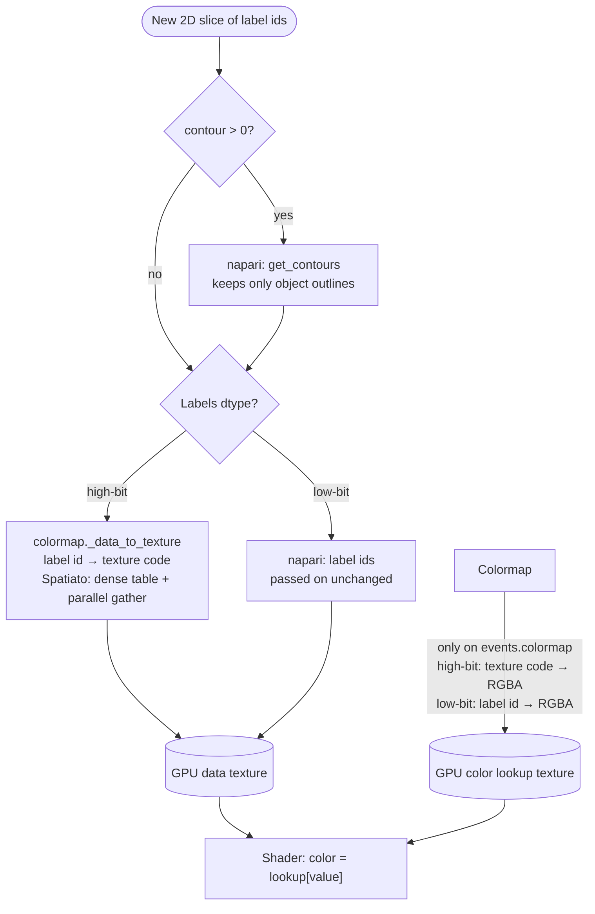
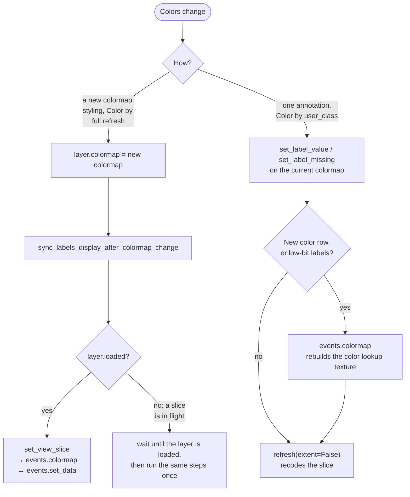

# Labels layers: coloring and rendering

This document describes how Spatiato colors napari Labels layers, and why it
replaces parts of napari's labels colormap. It covers which colormap a layer
gets, how napari turns a slice of label ids into colors on the GPU, which of
those steps Spatiato overrides and what each override fixes, and how a color
change reaches the screen. It is an internal developer contract, not user
documentation.

Not covered here: how a table column is chosen and validated for coloring, how
annotations are written to the table ([`classifier.md`](classifier.md),
[`table_state.md`](table_state.md)), and hover/feature lookup on the layer.

## Terminology

- **Label id:** a pixel value of the labels element. 0 is the background.
  A label id is matched to a table row through the table's instance key,
  within the rows whose region is that labels element.
- **Primary layer:** the main napari layer of a labels element, which the
  annotation widgets (Object Classification, Spatial Query) color and
  annotate. **Styled layer:** an extra layer for the same element, colored
  by one table column (`labels[source]`), created by the Viewer widget's
  "Add / Update in viewer".
- **High-bit / low-bit labels:** labels data with an integer dtype wider than
  16 bits (int32, uint32, int64, ...) or of at most 16 bits (uint8, int8,
  uint16, int16). napari draws the two differently (see "How napari draws a
  slice").
- **Texture code:** a small integer, one per distinct color, that napari
  draws instead of a high-bit label id. Texture codes are uint8 for up to 255
  colors, uint16 above.
- **Data texture:** the current slice as uploaded to the GPU, one value per
  pixel: texture codes for high-bit labels, label ids for low-bit labels.
- **Color lookup texture:** the table on the GPU that the shader uses to turn
  a data-texture value into RGBA: `texture code -> RGBA` for high-bit labels,
  `label id -> RGBA` (256 or 65,536 rows) for low-bit labels.
- **Compact mapping** (`CompactLabelsMapping`): Spatiato's color state for a
  table-styled layer. Three arrays: the table's label ids (sorted), one
  texture code per label id, and one RGBA row per texture code. Rows 0 and 1
  are fixed: 0 for labels without a table row (the default color), 1 for the
  background. A categorical mapping also has one row per category color and
  a row for missing values; a continuous mapping has one row per color bin
  and a row for missing values.
- **Dense table:** a `label id -> texture code` array with one entry per label
  id from 0 to the largest label id in the table, derived from the compact
  mapping.

## Which colormap a layer gets

| Layer and situation | Colormap |
|---|---|
| Primary layer as loaded, without styling | napari's default random colormap |
| Styled layer colored by instance id | napari's random colormap (`label_colormap`) |
| Styled layer colored by a categorical, boolean, 0/1 integer or string column; the primary layer in Spatial Query with an annotation column | `CompactLabelColormap`, categorical |
| Styled layer colored by another numeric column or a `var` | `CompactLabelColormap`, continuous (252 bins) |
| Primary layer in Object Classification, Color by `user_class` or `pred_class` | `CompactLabelColormap`, categorical, from the class palette in `uns` |
| Primary layer in Object Classification, Color by confidence | `CompactLabelColormap`, continuous, range 0 to 1 |
| Primary layer in Spatial Query without an annotation column; in Object Classification when the table is rejected | `NeutralLabelColormap`: every object in one neutral color |

In a table-styled layer, an object whose table row has no value (missing, or
not in the palette) gets the missing color, and an object without a table row
is transparent. Object Classification draws objects without a row in the
neutral color instead when no table is bound, so they do not disappear.

**Why a compact colormap.** napari's `DirectLabelColormap` keeps one
`label id -> RGBA` entry per label, validates every entry when it is built,
and derives more per-label mappings from it. For tables with hundreds of
thousands of objects, building and restyling that is slow and memory heavy.
`CompactLabelColormap` is a `DirectLabelColormap` that holds a compact mapping
instead: napari's model is built with a tiny color dict, and the napari hooks
that read colors are reimplemented over the compact arrays. One RGBA row per
color is also what makes the row-scoped annotation updates below possible.

## How napari draws a slice

A new slice is computed when the displayed z or time step changes, on a
refresh, and, for multiscale data, on every pan or zoom that changes the
visible region or resolution level. With async slicing, napari reads the slice
data in a worker thread, but turns it into the data texture on the Qt main
thread, so everything below the dtype branch runs on the main thread, for
every new slice of every visible labels layer (and its thumbnail).

A high-bit label id cannot index a GPU table directly: the table would need
billions of rows. So for high-bit labels napari recodes every slice on the CPU
into texture codes, and the color lookup texture has one row per color. For
low-bit labels a table with one row per possible label id fits on the GPU, so
napari skips the recoding.

The two textures are updated by different triggers. A refresh recomputes and
uploads the **data texture**. Only a colormap event
(`layer.events.colormap`, also emitted when `layer.colormap` is assigned)
rebuilds and uploads the **color lookup texture**.

## What Spatiato changes, and why

**Recoding high-bit slices with a dense table** (`CompactLabelColormap`,
[#130](https://github.com/vibspatial/spatiato/issues/130)). For a direct
colormap, napari recodes a high-bit slice with a parallel numba loop that
looks up every pixel in a typed dict (`label id -> texture code`). napari's
`DirectLabelColormap` builds that dict from its per-label colors;
`CompactLabelColormap` builds it from the compact arrays instead. A hash
lookup per pixel is much slower than the arithmetic napari's random colormap
uses on primary layers, so panning and zooming styled layers was visibly
slower. `CompactLabelColormap` now recodes high-bit slices itself, with the
dense table and a parallel gather: array indexing instead of hashing. The
typed dict is still used for `map` (thumbnails and single-label colors) and in
the fallback cases below. Values outside the dense table (label ids above the
largest table id, negative ids) get the default texture code, as with
napari's lookup.

napari's own path is kept where the dense table does not apply:

- low-bit labels, scalars and napari's "show selected label" mode;
- a negative background value;
- a dense table above 128 MB (`_DENSE_LUT_MAX_BYTES`), which happens with very
  large or hashed label ids;
- a dense table that cannot be allocated.

The last three are logged once per colormap (the negative background only at
debug level), so a slower layer can be explained. Colors are the same on both
paths.

**252 continuous bins** (`_CONTINUOUS_LABEL_BINS`). A continuous mapping has
the bins plus three rows (default, background, missing). 252 bins is the most
that keeps texture codes, and so the data texture, in uint8.

**A reserved missing row.** A categorical mapping always has a missing-value
row, even when no row is missing yet. Clearing an object's class then never
adds a row, so it never needs a colormap event on high-bit labels.

**A neutral colormap** (`NeutralLabelColormap`). It holds only the default
color and the background, and recodes a high-bit slice with one comparison
against the background value instead of napari's per-pixel lookup. It is not
a `CompactLabelColormap`, because that type marks table-styled layers: the
row-scoped annotation update requires it.

**napari's numba colormap backend.** Building a `CompactLabelColormap`
switches napari to its numba colormap backend for the session. The compact
colormap implements only that backend's hooks; napari's numpy backend would
need a per-label `label id -> texture code` array (`_array_map`), which the
compact colormap deliberately does not provide.

## Getting a color change onto the screen

**Assigning a new colormap.** Every place that assigns a table-driven or
neutral colormap then calls `ViewerAdapter.sync_labels_display_after_colormap_change`.
With async slicing, napari can rebuild the color lookup texture for the new
colormap before the slice has been recoded with it, which shows stale or
swapped colors ([napari#9188](https://github.com/napari/napari/issues/9188)).
The sync recomputes the slice, then emits the colormap event, then uploads the
data. If a slice is still in flight, it waits until the layer is loaded,
because recomputing the slice at that moment can crash inside dask's cache.

**One annotation** (Object Classification, Color by `user_class`). Building
and syncing a new colormap on every click would be too slow, so the widget
changes the layer's colormap in place: `set_label_value` or
`set_label_missing` gives the clicked object its class's texture code. Because
the colormap object stays the same, napari does not emit a colormap event by
itself. The widget emits one when the color lookup texture changed:

| Edit | High-bit labels | Low-bit labels |
|---|---|---|
| Existing class, or clearing the class | Only the object's texture code changes: the refresh is enough | The object's row in the lookup changes: colormap event |
| A class that has no color row yet | A row is added: colormap event | Colormap event |

If the clicked object's feature row cannot be matched, the widget falls back
to a full styling refresh. With Color by `pred_class` or confidence, an
annotation only updates the layer's features; colors are repainted when the
classifier writes new predictions.

## Caches

`CompactLabelColormap` builds these lazily, on first use, and keeps them on
the colormap:

- the dense table;
- one numba typed dict per labels dtype, for napari's per-pixel path:
  thumbnails and single-label colors (`map`), and the fallback cases above;
- napari's low-bit `label id -> RGBA` arrays, which become the color lookup
  texture for low-bit labels.

The compact mapping itself is never changed in place. An annotation builds a
new compact mapping and installs it, and installing clears all three caches,
so nothing derived from the old colors survives. This keeps one coherent
state, and costs about a millisecond per click even for a million table rows.
The "fallback already logged" flag is kept outside these caches, so it
survives an annotation and the fallback is not logged again after every
click.

## Limits

- **Private napari hooks.** The colormaps override private napari methods
  (`_data_to_texture`, `_get_typed_dict_mapping`,
  `_values_mapping_to_minimum_values_set`, `_label_mapping_and_color_dict`,
  `_map_without_cache`, `_clear_cache`) and use napari's private caches. The
  tests render through a real napari `Labels` layer with napari's per-pixel
  path disabled, and compare the overrides with napari's own paths, so a
  napari release that renames or changes these hooks fails there first.
- **Contours.** With `contour > 0`, napari computes the outlines of every new
  2D slice on the main thread before recoding it, for any colormap. This step
  is far slower than the recoding and is not sped up yet
  ([#136](https://github.com/vibspatial/spatiato/issues/136)).
- **napari's layer controls.** The color mode "auto" and the shuffle button in
  napari's Labels controls replace a styled layer's colormap with a random one
  ([#137](https://github.com/vibspatial/spatiato/issues/137)).

## Where to find it

- Colormaps: `CompactLabelsMapping`, `CompactLabelColormap` (`_data_to_texture`,
  `_get_dense_texture_lut`, `_get_typed_dict_mapping`, `map`,
  `_map_without_cache`, `_values_mapping_to_minimum_values_set`,
  `set_label_value`, `set_label_missing`, `_install_compact_mapping`),
  `compact_categorical_label_colormap_from_values`,
  `compact_continuous_label_colormap_from_values`, `NeutralLabelColormap`,
  `neutral_label_colormap`, `_DENSE_LUT_MAX_BYTES` and
  `_CONTINUOUS_LABEL_BINS` in
  [`src/spatiato/viewer/labels_colormap.py`](../../src/spatiato/viewer/labels_colormap.py).
- Styling: `apply_table_color_source_to_labels_layer` and
  `apply_neutral_labels_style` in
  [`src/spatiato/viewer/labels_styling.py`](../../src/spatiato/viewer/labels_styling.py).
- Display sync: `sync_labels_display_after_colormap_change` in
  [`src/spatiato/viewer/labels_async.py`](../../src/spatiato/viewer/labels_async.py);
  `ViewerAdapter.sync_labels_display_after_colormap_change`,
  `ensure_styled_labels_loaded` and `_build_labels_layer` in
  [`src/spatiato/viewer/adapter.py`](../../src/spatiato/viewer/adapter.py).
- Object Classification: `ViewerStylingController` (`refresh_layer_colors`,
  `refresh_user_class_colormap_and_feature`,
  `refresh_user_class_feature_only`) and `_colors_labels_by_label_id_on_gpu`
  in
  [`src/spatiato/widgets/object_classification/viewer_styling.py`](../../src/spatiato/widgets/object_classification/viewer_styling.py);
  `_refresh_after_user_class_annotation` and `_refresh_layer_styling` in
  [`src/spatiato/widgets/object_classification/widget.py`](../../src/spatiato/widgets/object_classification/widget.py).
- Spatial Query: `load_and_style_spatial_annotation_labels` and
  `load_and_style_unannotated_spatial_annotation_labels` in
  [`src/spatiato/widgets/spatial_query/viewer_styling.py`](../../src/spatiato/widgets/spatial_query/viewer_styling.py).
- napari: `Labels._raw_to_displayed` (contours and recoding) and
  `VispyLabelsLayer._on_colormap_change` (the color lookup texture).
- Tests: [`tests/test_labels_colormap.py`](../../tests/test_labels_colormap.py),
  [`tests/test_labels_styling.py`](../../tests/test_labels_styling.py),
  [`tests/test_labels_async.py`](../../tests/test_labels_async.py) and
  [`tests/test_viewer_styling.py`](../../tests/test_viewer_styling.py).
