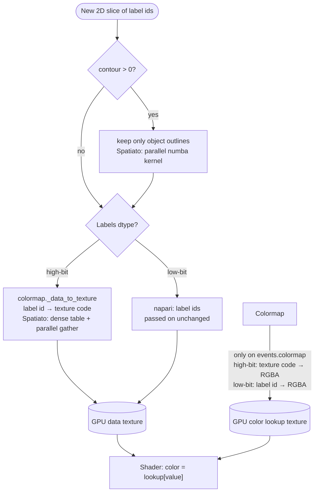
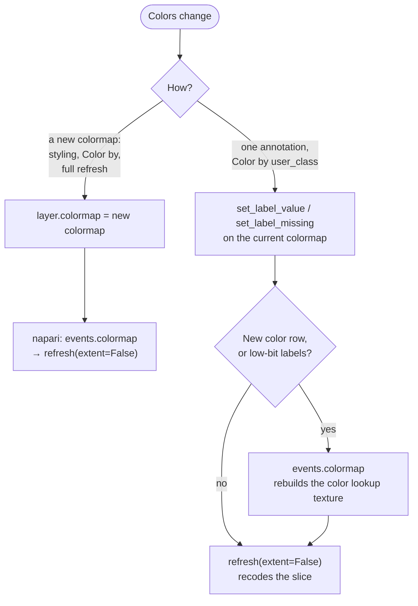

# Labels layers: coloring and rendering

This document describes how Spatiato colors napari Labels layers. It covers
which colormap a layer gets, how napari turns a slice of label ids into colors
on the GPU, what Spatiato's compact colormap is and how it keeps building and
drawing fast for large tables, and how a color change reaches the screen. It
is an internal developer contract, not user documentation.

Not covered here: how a table column is chosen and validated for coloring, how
annotations are written to the table ([`classifier.md`](classifier.md),
[`table_state.md`](table_state.md)), and hover/feature lookup on the layer.

## Terminology

- **Label id:** a pixel value of the labels element. 0 is the background.
  A label id is matched to a table row through the table's instance key,
  within the rows whose region is that labels element.
- **Primary layer:** the main napari layer of a labels element, which the
  annotation widgets (Object Classification, Spatial Query) color and
  annotate. **Styled layer:** an extra layer for the same element, colored
  by one table column (`labels[source]`), created by the Viewer widget's
  "Add / Update in viewer".
- **High-bit / low-bit labels:** labels data with an integer dtype wider than
  16 bits (int32, uint32, int64, ...) or of at most 16 bits (uint8, int8,
  uint16, int16). napari draws the two differently (see "How napari draws a
  slice").
- **Texture code:** a small integer, one per distinct color, that napari
  draws instead of a high-bit label id. Texture codes are uint8 for up to 255
  colors, uint16 above. See "Texture codes" for an example.
- **Data texture:** the current slice as uploaded to the GPU, one value per
  pixel: texture codes for high-bit labels, label ids for low-bit labels.
- **Color lookup texture:** the table on the GPU that the shader uses to turn
  a data-texture value into RGBA: `texture code -> RGBA` for high-bit labels,
  `label id -> RGBA` (256 or 65,536 rows) for low-bit labels.
- **Compact mapping** (`CompactLabelsMapping`): Spatiato's color state for a
  table-styled layer. Three arrays: the table's label ids (sorted), one
  texture code per label id, and one RGBA row per texture code. Rows 0 and 1
  are fixed: 0 for labels without a table row (the default color), 1 for the
  background. A categorical mapping also has one row per category color and
  a row for missing values; a continuous mapping has one row per color bin
  and a row for missing values.
- **Dense table:** a `label id -> texture code` array with one entry per label
  id from 0 to the largest label id in the table, derived from the compact
  mapping.

## Which colormap a layer gets

| Layer and situation | Colormap |
|---|---|
| Primary layer as loaded, without styling | napari's default random colormap |
| Styled layer colored by instance id | napari's random colormap (`label_colormap`) |
| Styled layer colored by a categorical, boolean, 0/1 integer or string column; the primary layer in Spatial Query with an annotation column | `CompactLabelColormap`, categorical |
| Styled layer colored by another numeric column | `CompactLabelColormap`, continuous (252 bins) |
| Styled layer colored by a `var` | `CompactLabelColormap`, continuous (252 bins; 251 plus a transparent zero row for non-negative values) |
| Primary layer in Object Classification, Color by `user_class` or `pred_class` | `CompactLabelColormap`, categorical, from the class palette in `uns` |
| Primary layer in Object Classification, Color by confidence | `CompactLabelColormap`, continuous, range 0 to 1 |
| Primary layer in Spatial Query without an annotation column; in Object Classification when the table is rejected | `NeutralLabelColormap`: every object in one neutral color |

In a table-styled layer, an object whose table row has no value (missing, or
not in the palette) gets the missing color, and an object without a table row
is transparent. Object Classification draws objects without a row in the
neutral color instead when no table is bound, so they do not disappear.

When a layer is colored by a `var` whose values are all non-negative (counts,
normalized or log1p data), an object with a value of exactly 0 is transparent
too: 0 means "not detected", and the colormap's lowest color (near black for
magma) would hide the image underneath. Zeros still count as the bottom of the
value range, so the other colors do not shift. Scaled data with negative values
keeps 0 as an ordinary value. Styled shapes and point-radius shapes follow the
same rule (`zeros_mean_not_detected`).

## How napari draws a slice

napari does not send a color per pixel to the GPU. It sends two textures
(arrays stored in GPU memory): the **data texture**, one number per pixel,
and the **color lookup texture**, a table from number to RGBA. A small GPU
program, the shader, then colors every pixel at once with
`color = lookup[number]`.

### Texture codes

For low-bit labels, the numbers in the data texture are the label ids
themselves: a lookup with one row per possible label id (256 or 65,536 rows)
fits on the GPU. A high-bit label id can be in the billions, far too many rows.
But many labels share a color, so napari numbers the distinct colors and puts
those numbers, the **texture codes**, in the data texture instead of the label
ids. The lookup then needs only one row per color.

For example, a table that colors cells by type:

```text
color lookup texture               compact mapping
(texture code -> RGBA)             (label id -> value -> texture code)
  0  transparent  (no table row)       101 -> tumor  -> 2
  1  transparent  (background)         102 -> tumor  -> 2
  2  red          (tumor)              103 -> stroma -> 3
  3  green        (stroma)           75115 -> stroma -> 3
  4  grey         (missing value)
```

A slice, before and after recoding:

```text
label ids (int32)               data texture: texture codes (uint8)
  0    0  101  101                1  1  2  2
103  103  101  999                3  3  2  0
```

Label 999 has no table row, so it gets code 0 and is transparent. The GPU
receives the uint8 array on the right and the five-row lookup; the pixels of
label 101 have code 2 and are drawn red.

Turning label ids into texture codes, the **recoding**, happens on the CPU in
the colormap's `_data_to_texture`, for every new slice.

### When it runs

A new slice is computed when the displayed z or time step changes, on a
refresh, and, for multiscale data, on every pan or zoom that changes the
visible region or resolution level. With async slicing, napari reads the slice
data in a worker thread, but turns it into the data texture on the Qt main
thread: the contour step and the recoding in the diagram below run on the main
thread, for every new slice of every visible labels layer. The viewer cannot
respond while they run, so their speed decides how smooth panning and zooming
feel.

For multiscale data, napari also loads the whole coarsest pyramid level with
every new slice, and runs the same contour step and recoding on it, although
nothing uses the result: the layer thumbnail only reads its raw label ids. The
cost follows the size of that level. It adds little with a deep pyramid, but
can be large with contours on
([#136](https://github.com/vibspatial/spatiato/issues/136#issuecomment-6761744238)).



The two textures are updated by different triggers. A refresh recomputes and
uploads the **data texture**. Only a colormap event
(`layer.events.colormap`, also emitted when `layer.colormap` is assigned)
rebuilds and uploads the **color lookup texture**.

## The compact colormap

`CompactLabelColormap` is the colormap of every table-styled layer. It is a
napari `DirectLabelColormap`, so napari draws it as a direct colormap, but it
does not hold napari's per-label colors. It holds a compact mapping: the
table's label ids, one texture code per label id, and one RGBA row per color,
as in the example in "Texture codes". The napari hooks that read colors are
implemented over these arrays.

### Why napari's direct colormap does not scale

A labels colormap costs time twice: when it is built, once per styling or
refresh, and when it draws, once for every new slice. napari's
`DirectLabelColormap` is slow at both for tables with hundreds of thousands
of objects:

- **Building.** It takes one `label id -> RGBA` entry per label. In Python
  loops over every label, it then validates each entry, counts the colors,
  and groups the labels by color to find their texture codes. For 500,000
  labels (synthetic, five colors) that takes about 2.5 s on the main thread
  and keeps over 100 MB of Python objects.
- **Drawing.** It recodes a high-bit slice through a numba typed dict from
  label id to texture code, for the example `{0: 1, 101: 2, 102: 2, 103: 3,
  75115: 3}`. A parallel loop looks up every pixel in the dict; a label id
  that is not in it gets code 0. Every lookup hashes the label id and searches
  the dict, millions of times per slice: about 10 ms for a 5.2 Mpx slice of
  synthetic labels. napari's random colormap computes its codes with
  arithmetic instead (about 1.6 ms), so a styled layer would pan and zoom
  visibly worse than the primary layer of the same labels element.

### Building: texture codes from the table

`CompactLabelColormap` never builds per-label colors. Each category or color
bin is one color, so the texture codes come straight from the table column,
computed with numpy. napari's model is built with a three-entry color dict.
The color count and the `label id -> texture code` view that napari reads are
derived from the arrays. napari's typed dict, needed only where the dense
table below cannot be used, is filled from them in one numba function. The
same 500,000 labels take about 20 ms and under 1 MB.

One RGBA row per color also makes annotation cheap: changing an object's
class changes one texture code (see "Getting a color change onto the
screen").

### Drawing: a dense table and a gather

For high-bit slices, `CompactLabelColormap` recodes with the dense table
instead of the dict ([#130](https://github.com/vibspatial/spatiato/issues/130)):
a plain array in which the position is the label id and the value is the
texture code. For the example:

```text
position:  0  1  2  …  101  102  103  …  999  …  75115
code:      1  0  0  …    2    2    3  …    0  …      3
```

The table is built for the colormap's first slice, and again after an
annotation edit. Recoding a slice is then `code = table[label id]` for every
pixel: reading a table at positions given by another array, a **gather**.
That is one memory read per pixel instead of a hash lookup, and numba runs it
on all CPU cores. Label ids beyond the end of the table, and negative ids, get
code 0, as with the dict. A 5.2 Mpx slice takes about 1 ms, on par with the
primary layer.

napari also colors the layer's thumbnail on every refresh, through the
colormap's `map`. It first downsamples the raw label ids to at most 32 × 32
pixels, and for high-bit labels `map` recodes those with the same cached dense
table, so the thumbnail adds well under a millisecond. A refresh therefore
recodes the slice and the thumbnail, plus, for multiscale data, the coarsest
level (see "When it runs"); the dense table itself is built only once.

The dense table's size follows the largest label id in the table, not the
number of objects: 75 KB in the example, with uint8 codes, but 100 MB for
label ids up to 100 million. napari's own path is used where the dense table
does not apply:

- low-bit labels, scalars and napari's "show selected label" mode;
- a negative background value;
- a dense table above 128 MB (`_DENSE_LUT_MAX_BYTES`), which happens with very
  large or hashed label ids;
- a dense table that cannot be allocated.

The last three are logged once per colormap (the negative background only at
debug level), so a slower layer can be explained. In those three cases, slices
and thumbnails go through napari's typed dict. Colors are the same on both
paths.

## Other decisions

### 252 continuous bins

`_CONTINUOUS_LABEL_BINS`. A continuous mapping has the bins plus three rows
(default, background, missing), and a fourth for transparent zeros when a
`var` is non-negative. 252 bins, or 251 with the zero row, is the most that
keeps texture codes, and so the data texture, in uint8.

### A reserved missing row

A categorical mapping always has a missing-value row, even when no row is
missing yet. Clearing an object's class then never adds a row, so it never
needs a colormap event on high-bit labels.

### A neutral colormap

`NeutralLabelColormap` holds only the default color and the background, and
recodes a high-bit slice with one comparison against the background value
instead of napari's per-pixel lookup. It is not a `CompactLabelColormap`, on
purpose. The one-click annotation update in Object Classification checks for
a `CompactLabelColormap` to know that it may edit one label's color in place;
a neutral layer has no table values to edit, so it must fail that check.
`CompactLabelColormap`'s constructor and hooks also expect a compact mapping,
and napari sometimes rebuilds a colormap through its own constructor
(`self.__class__(**self.model_dump())`), so the neutral colormap keeps
napari's.

### napari's numba colormap backend

Building a `CompactLabelColormap`
switches napari to its numba colormap backend for the session. The compact
colormap implements only that backend's hooks; napari's numpy backend would
need a per-label `label id -> texture code` array (`_array_map`), which the
compact colormap deliberately does not provide.

### Contours: a numba kernel on each layer

With `contour > 0`, napari keeps only the outline pixels of every new 2D slice
before recoding it: `Labels._calculate_contour` calls napari's `get_contours`,
a single-threaded scipy dilation and erosion on the main thread. On a 5.2 Mpx
slice that takes about 75 ms with contour 1 and 100 ms with contour 2, against
under 2 ms for the recoding. `install_fast_labels_contours` replaces
`_calculate_contour` on each layer with a parallel numba kernel that gives the
same output, including the border napari adds around partial slices: about
5 ms and 24 ms. Contours off, 3D slices and input the kernel does not take
still go through napari's method.

The contour step belongs to the `Labels` layer, not to the colormap, so it
applies to every Spatiato labels layer whatever its colormap.
`_build_labels_layer` builds all of them and installs the kernel. It is set on
each layer instance rather than patched into napari, so other plugins' layers
keep napari's behavior. napari's Duplicate layer builds a plain `Labels`, so a
duplicate uses napari's contours again. The upstream fix is tracked in
[#136](https://github.com/vibspatial/spatiato/issues/136).

## Getting a color change onto the screen



**Assigning a new colormap.** napari's colormap setter handles this on its
own: it emits the colormap event, which rebuilds the color lookup texture, and
refreshes the layer, which recodes the slice with the new colormap. Before
napari 0.9.0, async slicing could build the lookup texture for napari's
placeholder slice and keep it after the real slice arrived, which showed stale
or swapped colors ([napari#9188](https://github.com/napari/napari/issues/9188)).
napari now rebuilds it when the slice's dtype changes. With async slicing, the
previous slice can still be drawn with the new lookup texture for a moment,
until the recoded slice arrives.

**One annotation** (Object Classification, Color by `user_class`). Building
and assigning a new colormap on every click would be too slow, so the widget
changes the layer's colormap in place: `set_label_value` or
`set_label_missing` gives the clicked object its class's texture code. Because
the colormap object stays the same, napari does not emit a colormap event by
itself. The widget emits one when the color lookup texture changed:

| Edit | High-bit labels | Low-bit labels |
|---|---|---|
| Existing class, or clearing the class | Only the object's texture code changes: the refresh is enough | The object's row in the lookup changes: colormap event |
| A class that has no color row yet | A row is added: colormap event | Colormap event |

If the clicked object's feature row cannot be matched, the widget falls back
to a full styling refresh. With Color by `pred_class` or confidence, an
annotation only updates the layer's features; colors are repainted when the
classifier writes new predictions.

## Caches

`CompactLabelColormap` builds these lazily, on first use, and keeps them on
the colormap:

- the dense table;
- one numba typed dict per labels dtype, for napari's per-pixel path, built
  only where the dense table cannot be used;
- napari's low-bit `label id -> RGBA` arrays, which become the color lookup
  texture for low-bit labels.

The compact mapping itself is never changed in place. An annotation builds a
new compact mapping and installs it, and installing clears all three caches,
so nothing derived from the old colors survives. This keeps one coherent
state. Installing the new mapping and rebuilding the dense table cost about a
millisecond per click for a million table rows.
The "fallback already logged" flag is kept outside these caches, so it
survives an annotation and the fallback is not logged again after every
click.

## Limits

- **Private napari hooks.** The colormaps override private napari methods
  (`_data_to_texture`, `_get_typed_dict_mapping`,
  `_values_mapping_to_minimum_values_set`, `_label_mapping_and_color_dict`,
  `_map_without_cache`, `_clear_cache`) and use napari's private caches. The
  tests render through a real napari `Labels` layer with napari's per-pixel
  path disabled, and compare the overrides with napari's own paths, so a
  napari release that renames or changes these hooks fails there first. The
  contour kernel replaces `Labels._calculate_contour`, and a test fails if
  napari's scipy contours run again on a Spatiato layer.
- **Contours.** The contour kernel still runs on the main thread, and thick
  contours cost more: about 24 ms for contour 2 on a 5.2 Mpx slice, against
  5 ms for contour 1
  ([#136](https://github.com/vibspatial/spatiato/issues/136)).
- **napari's layer controls.** The color mode "auto" and the shuffle button in
  napari's Labels controls replace a styled layer's colormap with a random one
  ([#137](https://github.com/vibspatial/spatiato/issues/137)).

## Where to find it

- Colormaps: `CompactLabelsMapping`, `CompactLabelColormap` (`_data_to_texture`,
  `_get_dense_texture_lut`, `_get_typed_dict_mapping`, `map`,
  `_map_without_cache`, `_values_mapping_to_minimum_values_set`,
  `set_label_value`, `set_label_missing`, `_install_compact_mapping`),
  `compact_categorical_label_colormap_from_values`,
  `compact_continuous_label_colormap_from_values`, `NeutralLabelColormap`,
  `neutral_label_colormap`, `_DENSE_LUT_MAX_BYTES` and
  `_CONTINUOUS_LABEL_BINS` in
  [`src/spatiato/viewer/labels_colormap.py`](../../src/spatiato/viewer/labels_colormap.py).
- Styling: `apply_table_color_source_to_labels_layer` and
  `apply_neutral_labels_style` in
  [`src/spatiato/viewer/labels_styling.py`](../../src/spatiato/viewer/labels_styling.py).
- Contours: `labels_contours`, `install_fast_labels_contours` and
  `_calculate_labels_contour` in
  [`src/spatiato/viewer/labels_contours.py`](../../src/spatiato/viewer/labels_contours.py).
- Adapter: `ensure_styled_labels_loaded` and `_build_labels_layer` in
  [`src/spatiato/viewer/adapter.py`](../../src/spatiato/viewer/adapter.py).
- Object Classification: `ViewerStylingController` (`refresh_layer_colors`,
  `refresh_user_class_colormap_and_feature`,
  `refresh_user_class_feature_only`) and `_colors_labels_by_label_id_on_gpu`
  in
  [`src/spatiato/widgets/object_classification/viewer_styling.py`](../../src/spatiato/widgets/object_classification/viewer_styling.py);
  `_refresh_after_user_class_annotation` and `_refresh_layer_styling` in
  [`src/spatiato/widgets/object_classification/widget.py`](../../src/spatiato/widgets/object_classification/widget.py).
- Spatial Query: `load_and_style_spatial_annotation_labels` and
  `load_and_style_unannotated_spatial_annotation_labels` in
  [`src/spatiato/widgets/spatial_query/viewer_styling.py`](../../src/spatiato/widgets/spatial_query/viewer_styling.py).
- napari: `Labels._raw_to_displayed` (contours and recoding),
  `Labels._calculate_contour` and `get_contours` (napari's contours),
  `Labels._set_colormap` (the colormap event and refresh),
  `VispyLabelsLayer._on_colormap_change` (the color lookup texture) and
  `VispyLabelsLayer._on_data_change` (its rebuild when the slice dtype changes).
- Tests: [`tests/test_labels_colormap.py`](../../tests/test_labels_colormap.py),
  [`tests/test_labels_contours.py`](../../tests/test_labels_contours.py),
  [`tests/test_labels_styling.py`](../../tests/test_labels_styling.py) and
  [`tests/test_viewer_styling.py`](../../tests/test_viewer_styling.py).
