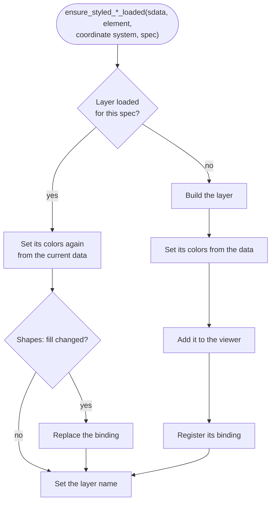

# Styled layers: loading, restyling and removal

This document describes how Spatiato creates, restyles and removes the styled
labels and shapes layers of the Viewer widget: what identifies a styled layer,
in which order a layer is built, colored, added and registered, which state
lives on its binding, and which signals report that the loaded layers changed.
It is an internal developer contract, not user documentation.

Not covered here: how a labels layer's colors are drawn
([`labels_coloring.md`](labels_coloring.md)), how annotations are written to
the table ([`classifier.md`](classifier.md), [`table_state.md`](table_state.md)),
and which columns are offered as color sources
([`src/spatiato/core/color_source_options.py`](../../src/spatiato/core/color_source_options.py)).

## Terminology

- **Primary layer:** the main napari layer of a labels or shapes element, the
  one the annotation widgets color and edit. One per element and coordinate
  system.
- **Styled layer:** an extra, viewer-only layer of the same element, colored
  by one color source and named `<element>[<source label>]`, for example
  `blobs_labels[obs: cell_type]`. An element can have several, one per
  source.
- **Color source spec:** what a styled layer is colored by.
  `TableColorSourceSpec` names an `obs` column, or a var of one matrix, of a
  linked table. `ShapeColumnColorSourceSpec` names a column of the shapes
  GeoDataFrame itself, and is used for shapes only.
- **Binding:** the entry of a layer in `LayerBindingRegistry`, keyed by the
  layer object: `LabelsLayerBinding` or `ShapesLayerBinding`. It records the
  SpatialData object, element, coordinate system and role of the layer and,
  for a styled layer, its spec. Bindings are frozen dataclasses.
- **Rendering mode** (shapes): `"shapes"` for a napari `Shapes` layer, or
  `"points"` for point-radius shapes (every geometry a circle), which are drawn
  as a napari `Points` layer.
- **Rendered-row mapping** (shapes): `source_row_id_by_rendered_row`, the
  GeoDataFrame row of each napari row. One source row can give several napari
  rows, for example the parts of a `MultiPolygon`. Coloring uses it to give
  every part the value of its source row.

## One layer per source

A styled layer is identified by its SpatialData object, element, coordinate
system and spec. `ensure_styled_labels_loaded` and
`ensure_styled_shapes_loaded` look the layer up by these and restyle it when
it is already loaded, so loading a source twice never gives two layers.

This works because a spec names only the data (the table, source kind, key
and matrix, or the shapes column) and is compared by plain equality. It does
not say how the data is colored. Whether values are colored as categories or
with a continuous colormap is decided by `classify_color_values` from the
current values, each time a layer is colored, and reported in the style
result (`value_kind`). A column whose values changed kind, for example from
0/1 integers to other numbers, therefore restyles the same layer, now with a
continuous colormap.

Do not add fields to a spec that describe how its data is colored or shown:
two specs for the same data would no longer be equal, and one source could
get two layers. Display state such as Fill belongs on the binding (see "State
on the binding").

## Loading and restyling

`ensure_styled_labels_loaded` and `ensure_styled_shapes_loaded` load a new
layer, or restyle the loaded one from the current data:

Coloring only sets the layer's colors and features: the colormap of a labels
layer, or the face and edge colors of a shapes layer (face and border colors
when it is rendered as `Points`). napari draws them once the layer is in the
viewer, so a new layer shows its colors when it is added, and a loaded layer
shows the new colors right away.

**A new layer is colored before it is added.** If coloring raises, for
example for a column without any value, the layer was never shown or
registered: it is dropped and the error is raised. No uncolored layer is left
in the viewer.

**A failed restyle keeps the layer.** If coloring a loaded layer raises, the
layer keeps its binding and the colors it had, and the error is raised.

**A failed registration removes the layer.** Registration runs once the layer
is in the viewer. If it raises, `_remove_layer_after_failed_registration`
removes the layer again before the error is raised. A layer without a binding
would look like one the user added; the Annotation widget, for example, adopts
unbound shapes layers.

**The name is set last.** napari makes a name unique when a layer is inserted,
by appending a number, and the user can rename a loaded layer. Setting
`<element>[<source label>]` at the end gives a new or restyled layer its
source name in both cases.

**Coloring uses only the layer and the data.** This is what makes the order
possible. `apply_table_color_source_to_labels_layer`,
`apply_table_color_source_to_shapes_layer` and
`apply_shape_column_color_source_to_shapes_layer` read the layer, `sdata` and
the spec, never the viewer or the binding registry. New coloring code must
keep to this: if it needed the binding, a new layer could only be colored
after registration, and a failed first coloring would leave a layer behind.
napari keeps the colors and features set on a layer before it is inserted;
tests load styled layers into a real `ViewerModel` to check this.

**Shapes are colored through the rendered-row mapping.** A new shapes layer
has no binding yet, so it is colored with the mapping from the build result
(`_BuiltShapesLayer`). The same mapping is then stored on the binding, and a
restyle reads it from there. `_apply_styled_shapes_color_source` picks the
coloring function for the spec in both cases. Labels need no such mapping: a
label id is matched to its table row directly.

## State on the binding

Spatiato reads the state of a styled layer from its binding, not from the
layer or from a widget:

- `style_spec`: the source, used to find the layer and to restyle it;
- shapes only: `shapes_rendering_mode`, the rendered-row mapping,
  `source_shapes_index_feature_name`, `skipped_geometry_count` (source rows
  whose geometry could not be drawn) and `fill`.

**Fill.** `ShapesLayerBinding.fill` records whether a styled layer fills its
shapes with their colors or only colors their edges. It is stored because it
cannot be read back from the layer: fill only sets the face alpha
(`_styled_shapes_face_alpha`), and shapes without a table row or with a
not-detected value get face alpha 0 as well, so a layer whose shapes are all
hidden looks unfilled either way. Code that restyles a layer passes the
binding's `fill`, so the layer keeps it.

- Only a styled layer rendered as `Shapes` can have `fill=True`; the binding
  rejects any other. A `Points` layer is always filled, so
  `ensure_styled_shapes_loaded` records `False` for it, whatever `fill` it is
  given.
- A restyle with another `fill` replaces the binding. Bindings are frozen, so
  the new one is built with `dataclasses.replace`, which keeps every other
  field, and stored with `LayerBindingRegistry.replace_binding`. It is replaced
  only after coloring succeeded, so it always records the fill the layer shows.
- A restyle with the same `fill` keeps the binding object.

## Membership signals

`ViewerAdapter.labels_layers_changed` and `ViewerAdapter.shapes_layers_changed`
report that the set or order of loaded labels or shapes layers changed,
primary or styled. They carry no data. A listener re-queries the registry and
the viewer, for example with `get_loaded_labels_layers`, which returns every
labels layer of an element, primary and styled, in viewer order: after a
removal the binding is already gone when the signal fires, so a payload would
be out of date. The Viewer widget's labels cards are such listeners (see "The
labels card").

They are emitted:

- when a layer in the viewer gets a binding (`_handle_registered_binding`);
- when a layer that has a binding is inserted into the viewer
  (`_on_viewer_layer_inserted`);
- when a layer with a binding is removed from the viewer
  (`_on_viewer_layer_removed`), or removed by the adapter from a viewer that
  emits no removal event (`_remove_layer_from_viewer_and_registry`);
- when the viewer's layers are reordered and a layer with a binding is among
  them (`_on_viewer_layers_reordered`);
- shapes only: when the binding of a loaded shapes layer is replaced, after a
  Fill change or by `sync_primary_shapes_layer_binding`. Code that keeps
  binding objects must read them again then.

Every labels or shapes binding counts, also one without a SpatialData object
or coordinate system; listeners filter on those when they re-query. A restyle
that keeps the binding object emits nothing, so a listener that rebuilds its
rows does not do so on every restyle. Changes to visibility, opacity or colors
emit nothing either: a listener that follows those connects to the napari
layer's own events. `image_layers_changed` follows the same rules for image
layers.

## Removing a styled layer

`remove_styled_labels_layer` and `remove_styled_shapes_layer` remove the layer
of one source and leave the element's other layers, primary and styled. They
find it with the `style_spec` filter of `get_loaded_styled_labels_layers` and
`get_loaded_styled_shapes_layers`, return `None` when no layer is loaded for
the spec, and raise `ValueError` when more than one is, since that breaks the
one-layer-per-source rule. The layer is removed through
`_remove_layer_from_viewer_and_registry`, which also unregisters its binding,
so the membership signal fires.

`remove_layers_for_sdata` and `remove_layers_outside_coordinate_system`
remove styled layers together with every other layer of a SpatialData object
or of the other coordinate systems.

## The labels card

The labels card of the Viewer widget (`_LabelsCardWidget`) is where a user
loads, hides and removes the layers of one labels element. It follows the
image card's pattern:

- **Loading on pick.** Accepting a source in the card's search field, by
  picking a completion or pressing Enter on an exact name, loads its styled
  layer at once through `ensure_styled_labels_loaded`. There is no apply
  button. The search field offers only sources that are not loaded, so the
  card never restyles a loaded layer. A failed first load leaves no layer
  (see "Loading and restyling"), so no row appears and the source stays
  offered.
- **The primary layer has its own row.** It is loaded only with the card's
  **Load in viewer** button, never as a side effect of picking a source, and
  is kept out of the list of styled layers and out of "Remove all".
- **Rows come from live state.** The card keeps no list of loaded layers of
  its own. On every `labels_layers_changed`, the Viewer widget reads the
  element's layers with `get_loaded_labels_layers`, splits them into the
  primary binding and the styled bindings, and passes both to
  `set_loaded_labels_bindings`. A row is kept while its binding object is
  unchanged, and built again when it changes. A kept row is relabelled with
  `set_display_label` when its table-name prefix is switched on or off. The styled rows are in napari
  layer order, in a `_StyledLayerList` that the shapes card is meant to reuse.
- **Rows only emit intent.** A row's eye and × buttons emit intent with the
  binding the row was built for. The Viewer widget resolves the live binding
  and then sets `layer.visible`, or calls `remove_labels_layer` or
  `remove_styled_labels_layer`. The rows follow visibility through napari's
  own `visible` event.
- **Rows are disposed.** Before the labels cards are rebuilt or cleared, the
  Viewer widget disposes them, so no deleted row stays connected to a layer
  event.

## Where to find it

- Adapter: `ensure_styled_labels_loaded`, `ensure_styled_shapes_loaded`,
  `get_loaded_labels_layers`,
  `get_loaded_styled_labels_layer(s)`, `get_loaded_styled_shapes_layer(s)`,
  `remove_styled_labels_layer`, `remove_styled_shapes_layer`,
  `_build_labels_layer`, `_build_shapes_layer`,
  `_apply_styled_shapes_color_source`,
  `_remove_layer_after_failed_registration`,
  `_remove_layer_from_viewer_and_registry`, and the membership signals with
  `_handle_registered_binding`, `_on_viewer_layer_inserted`,
  `_on_viewer_layer_removed` and `_on_viewer_layers_reordered`, in
  [`src/spatiato/viewer/adapter.py`](../../src/spatiato/viewer/adapter.py).
- Bindings: `LabelsLayerBinding`, `ShapesLayerBinding` and
  `LayerBindingRegistry` (`register_*_layer`, `replace_binding`,
  `find_bindings`), in the same module.
- Specs: `TableColorSourceSpec` and `ShapeColumnColorSourceSpec` in
  [`src/spatiato/core/_color_source.py`](../../src/spatiato/core/_color_source.py).
- Classification: `classify_color_values` in
  [`src/spatiato/core/color_value_classification.py`](../../src/spatiato/core/color_value_classification.py).
- Coloring and names: `apply_table_color_source_to_labels_layer` and
  `build_styled_labels_layer_name` in
  [`src/spatiato/viewer/labels_styling.py`](../../src/spatiato/viewer/labels_styling.py);
  `apply_table_color_source_to_shapes_layer`,
  `apply_shape_column_color_source_to_shapes_layer`,
  `build_styled_shapes_layer_name` and `_styled_shapes_face_alpha` in
  [`src/spatiato/viewer/shapes_styling.py`](../../src/spatiato/viewer/shapes_styling.py).
- Viewer widget: for labels, `_add_styled_labels_source`,
  `_remove_styled_labels_source`, `_remove_all_styled_labels_sources`,
  `_change_styled_labels_visibility`, `_load_primary_labels_layer`,
  `_remove_primary_labels_layer`, `_change_primary_labels_visibility`,
  `_on_labels_layers_changed`, `_refresh_labels_card_membership` and
  `_get_live_labels_bindings`; for shapes, `_add_or_update_styled_shapes_layer`;
  in [`src/spatiato/widgets/viewer/widget.py`](../../src/spatiato/widgets/viewer/widget.py).
- Cards: `_LabelsCardWidget` in
  [`src/spatiato/widgets/viewer/labels_widget.py`](../../src/spatiato/widgets/viewer/labels_widget.py),
  `_StyledLayerList` in
  [`src/spatiato/widgets/viewer/styled_layer_list.py`](../../src/spatiato/widgets/viewer/styled_layer_list.py),
  and the row `_LayerRow` in
  [`src/spatiato/widgets/layer_row.py`](../../src/spatiato/widgets/layer_row.py).
- Tests: [`tests/test_viewer_adapter.py`](../../tests/test_viewer_adapter.py),
  [`tests/test_labels_styling.py`](../../tests/test_labels_styling.py),
  [`tests/test_shapes_styling.py`](../../tests/test_shapes_styling.py),
  [`tests/test_styled_layer_list.py`](../../tests/test_styled_layer_list.py) and
  [`tests/test_viewer_widget.py`](../../tests/test_viewer_widget.py).
