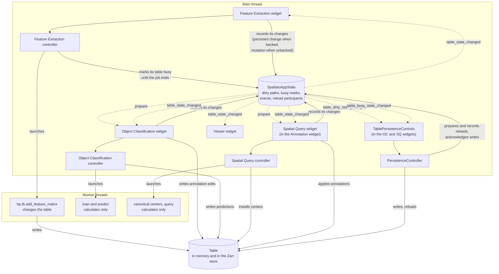

# Table state, persistence and reloads

This document describes how Spatiato keeps an AnnData table consistent across
its widgets, memory and the Zarr store: who changes a table, how a change is
announced, what Write and Reload do, and how running jobs interact with them.
It is an internal developer contract, not user documentation.

Not covered here: Shapes elements (their own written and reloaded events),
coordinate-system changes (their own participant protocol), and how Feature
Extraction decides what to calculate
([`feature_extraction.md`](feature_extraction.md)).

## Terms

- **Backed:** `sdata.path` is set, so each table also lives in a Zarr store.
  **Unbacked:** the table exists only in memory. Write and Reload exist only
  for backed SpatialData.
- **Component path** (`TableComponentPath`): an `obs` column, an `obsm` key or
  an `uns` path; the unit Spatiato tracks, writes and reloads. Any `obs` path
  covers the whole `obs` dataframe, an `obsm` path only its key, and an `uns`
  path also everything nested below it.
- **Dirty path:** a component path changed in memory and not yet written. App
  state keeps the dirty paths per SpatialData object and table, each with a
  token that identifies its latest change. Unbacked SpatialData has dirty
  paths too, but cannot write them.
- **Mutation:** a change that exists only in memory. A widget records it with
  `record_table_mutation(event)`, which makes its paths dirty.
- **Persisted change:** a change that is already in the store when it is
  recorded, because harpy wrote it. A widget records it with
  `record_persisted_table_change(event, snapshot)`, which makes none of its
  paths dirty.
- **Dirty snapshot** (`TableDirtySnapshot`): the dirty paths and their tokens
  at one moment. A path that is persisted later becomes clean only if its
  token is still the one in the snapshot, so a newer change stays dirty.
- **Busy:** a table is busy while a job writes it from a worker thread, in
  memory or in its store. The job's owner marks it with
  `mark_table_busy(sdata, table_name, reason=...)`, which returns a mark, and
  passes the mark to `release_table_busy(mark)` when the job ends. A busy
  table can be neither written nor reloaded. App state keeps the marks per
  SpatialData object and table; two jobs on one table hold two marks. The
  job's owner sees only these two methods, through the `TableBusyMarker`
  protocol, which app state implements.
- **Reload:** replacing the in-memory components of one table with the ones in
  the store.
- **Reload participant:** an object whose work depends on a table. Right
  before the table is reloaded, app state asks it to invalidate that work
  (`prepare_for_table_reload()`), as a defense: it also invalidates that work
  on the `reloaded` event.

Signals and calls, as the diagram labels them:

- **Records its changes:** after a widget changes a table, it tells app state
  about it, as a mutation or a persisted change. App state then updates the
  dirty paths and passes the change on to every widget through
  `table_state_changed`. If that makes the table as a whole dirty or clean, it
  also emits `table_dirty_state_changed`. So the widget that made the change
  only talks to app state, and the others only listen to app state. A change
  that is not recorded is never passed on, and never becomes dirty.
- **`table_state_changed`:** app state's signal that something in a table
  changed, for example a column was edited or a feature matrix was written.
  It is emitted for every recorded change, a reload included. It carries a
  `TableStateChangedEvent` that says what changed (the component paths, and
  the regions whose rows changed), how (the change kind) and who changed it
  (the source). Widgets use it to adapt to the new contents.
- **`table_dirty_state_changed`:** app state's signal that a table became
  dirty (it now has unsaved changes) or clean again (it has none left). It
  carries the table and `is_dirty`, nothing about what changed, and is
  emitted only at that moment, not on every change. It reflects Spatiato's
  records, not a comparison with the store: a change made outside the widgets,
  for example from the napari console, is not seen. The persistence controls
  use it for the Write button and the Reload warning.
- **Marks its table busy:** the owner of a job that writes the table marks it
  busy when the job launches and releases the mark when the job ends.
- **`table_busy_state_changed`:** app state's signal that a table became busy
  or is no longer busy. It carries the table and `is_busy`; the reasons are
  read from app state (`table_busy_reasons(...)`). The persistence controls
  use it to disable Write and Reload while the table is busy, with the reason
  as tooltip.
- **Prepare:** before a reload, app state first refuses a busy table, with
  `TableBusyError`. Only otherwise does every participant's
  `prepare_for_table_reload()` invalidate its work that depends on the table.

## The pieces

| Piece | Where | Responsibility |
|---|---|---|
| `SpatiatoAppState` | [`_app_state.py`](../../src/spatiato/_app_state.py) | One per napari viewer. Keeps the dirty paths and the busy marks, publishes `table_state_changed` (one change, with its component paths), `table_dirty_state_changed` (a table became dirty or clean) and `table_busy_state_changed` (a table became busy or no longer busy), and prepares reloads with its reload participants. |
| `TablePersistenceControls` | [`widgets/persistence/controls.py`](../../src/spatiato/widgets/persistence/controls.py) | The Write and Reload buttons, embedded in the Object Classification and Spatial Query widgets. Disables both while the table is busy, asks Write / Discard / Cancel before reloading a dirty table, and shows errors. |
| `PersistenceController` | [`widgets/persistence/controller.py`](../../src/spatiato/widgets/persistence/controller.py) | One per set of controls. Writes the dirty paths, and captures and runs a reload. |
| Table I/O | [`core/persistence.py`](../../src/spatiato/core/persistence.py) | Writes and reads the components of one table in the store. |
| Widgets and their controllers | `widgets/<workflow>/` | Change the table, record each change in app state, and adopt changes made by others. |
| Workers | threads started by the controllers | Calculate. Only a harpy call changes the table from a worker. |

The Spatial Query widget is not a napari widget of its own: it is part of the
Annotation widget, below Shapes Annotation.

## How they connect

Solid arrows are calls, dotted arrows are signals and callbacks from app
state.

Widgets never tell each other about table changes directly: everything they
need to know about another widget's change to a table arrives through app
state.

## Changing a table

Every change is recorded in app state by the widget that made it, with a
`TableStateChangedEvent`: the SpatialData object, the table, the component
paths, the regions whose rows changed, a change kind (`created`, `updated`,
`removed`, `rebuilt` or `reloaded`) and a source. How it is recorded depends on
where the change is:

| The change is | Recorded with | Effect on dirty paths | Examples |
|---|---|---|---|
| only in memory | `record_table_mutation(event)` | each path becomes dirty, with a new token | Object Classification's annotation edits, predictions and configuration; Spatial Query's annotations and canonical centers; Feature Extraction on unbacked SpatialData |
| already in the store | `record_persisted_table_change(event, snapshot)` | none becomes dirty; a path that was dirty in the snapshot taken at launch and that harpy wrote becomes clean, unless it changed again since | Feature Extraction on backed SpatialData |

Both publish the event on `table_state_changed`, and, when the table as a whole
becomes dirty or clean, also `table_dirty_state_changed`. Consumers filter on
the SpatialData object, the table, the source and the change kind. For example,
Object Classification refreshes its feature-matrix choices on a
`feature_extraction` event, and every workflow adopts a `reloaded` event.
Publishing an event never makes a path clean by itself.

## Write

1. Write in the persistence controls calls
   `PersistenceController.write_table_state()`. The button is disabled while
   the table is busy.
2. It refuses a busy table (`require_table_not_busy(...)` raises
   `TableBusyError`, and the controls show it), so callers other than the
   button are guarded too.
3. Otherwise it takes a dirty snapshot and writes exactly those paths to the
   store, on the main thread. Without dirty paths there is nothing to write,
   and the table is left as it is.
4. `acknowledge_table_write(snapshot, persisted_paths=...)` makes each written
   path clean if its token is still the one in the snapshot.
5. When the table as a whole becomes clean, `table_dirty_state_changed`
   refreshes every set of persistence controls bound to it.

## Reload

1. Reload in the persistence controls is disabled while the table is busy.
   When the table is dirty, the controls ask Write / Discard / Cancel. Write
   writes before reloading, Discard reloads over the unsaved changes, and
   Cancel stops.
2. The persistence controller captures a `TableReloadRequest`: the table, and
   every component path in memory or in the store, plus the dirty paths.
3. `app_state.prepare_for_table_reload(request)` runs two passes:
   1. if the table became busy meanwhile, for example because a job started
      while the dialog was open, it raises `TableBusyError` with every reason
      and the controls show it: no participant has acted and the table is not
      reloaded. If the user chose Write in step 1, that write has already
      happened and is not undone: the changes are in the store, and the table
      is clean;
   2. otherwise every participant's `prepare_for_table_reload(request)`
      invalidates its work that depends on the old table.
4. The components are read from the store and replaced in memory. A failure
   while reading changes nothing; a failure while validating the replaced
   components restores the previous ones.
5. `record_table_reload(event)` makes every reloaded path clean and publishes
   the event with change kind `reloaded`. Each workflow adopts it: it refreshes
   its choices from the reloaded table, binds them again, and invalidates its
   work that depended on the old table.

A reload replaces the components of one table only.

## Jobs, Write and Reload

What happens to a running job depends on where its result ends up in the
table:

- **The worker changes the table itself**, in memory or in the store, as a
  harpy call does. It can be neither interrupted nor undone, and a Write or
  Reload during it would race with it: a Write would put a second writer on
  the same store, a reload could read a half-written store, and harpy could
  install its result in the reloaded table afterwards. The job's owner marks
  the table **busy** until the job ends, so Write and Reload wait for it.
- **The worker only calculates**, and the result is written on the main thread
  when it arrives, as a new change. The table is not busy. Before a reload,
  the workflow **invalidates** the job in `prepare_for_table_reload()`: the
  result, calculated from the table being replaced, is discarded and never
  written to the table.

| Workflow | Its jobs | Before a reload |
|---|---|---|
| Feature Extraction | write the table through harpy: its controller marks the table busy until the job ends | nothing: not a reload participant |
| Object Classification | only calculate | its widget freezes the classifier work: cancels its jobs and drops its model snapshot |
| Spatial Query | only calculate | its widget invalidates the Run |

Feature Extraction needs no prepare hook: while its job runs, the table is busy
and cannot be reloaded, and once the job has ended, its result is already
published, so no work tied to the old table remains. It only adopts the
reloaded table, from the `reloaded` event.

Feature Extraction's widget gives its controller app state as a
`TableBusyMarker`. The controller marks the table busy in `calculate()` and
releases the mark in `_clear_job()`, which every end of a job reaches: it
returned, errored, failed to start, or finished after the widget closed. After
the widget closes, superqt keeps the running worker alive, and the worker's
signal connections keep the controller alive, so the release still happens.

A workflow that only invalidates registers its widget as a reload participant
and unregisters it when the widget is destroyed. It also invalidates its work
when it receives the `reloaded` event. Since a reload runs synchronously on the
main thread, that event alone would discard late results; the participant hook
is a defense that does not rely on that ordering. Because the busy check runs
before any participant prepares, a refused reload changes nothing in any
workflow.

When adding a workflow: a job whose worker writes the table marks it busy at
launch and releases the mark at every end of the job. Work that depends on the
table registers with `register_table_reload_participant()`, implements
`prepare_for_table_reload()`, also invalidates its work on the `reloaded`
event, and compares the request's SpatialData object (by identity) and table
name with its own before acting.

## Where to find it

- App state: `TableStateChangedEvent`, `TableDirtySnapshot`,
  `TableBusyMark`, `TableBusyMarker`, `TableBusyStateChangedEvent`,
  `TableBusyError`, `TableReloadRequest`, `TableReloadParticipant`,
  `record_table_mutation`, `record_persisted_table_change`,
  `record_table_reload`, `acknowledge_table_write`, `mark_table_busy`,
  `release_table_busy`, `is_table_busy`, `table_busy_reasons`,
  `require_table_not_busy` and `prepare_for_table_reload` in
  [`src/spatiato/_app_state.py`](../../src/spatiato/_app_state.py).
- Persistence: `TablePersistenceControls` in
  [`src/spatiato/widgets/persistence/controls.py`](../../src/spatiato/widgets/persistence/controls.py),
  `PersistenceController` in
  [`src/spatiato/widgets/persistence/controller.py`](../../src/spatiato/widgets/persistence/controller.py),
  `write_table_components` and `reload_table_components` in
  [`src/spatiato/core/persistence.py`](../../src/spatiato/core/persistence.py).
- Busy marks: `calculate` and `_clear_job` in
  [`widgets/feature_extraction/controller.py`](../../src/spatiato/widgets/feature_extraction/controller.py).
- Participants: `prepare_for_table_reload` in
  [`widgets/object_classification/widget.py`](../../src/spatiato/widgets/object_classification/widget.py)
  and
  [`widgets/spatial_query/widget.py`](../../src/spatiato/widgets/spatial_query/widget.py).
