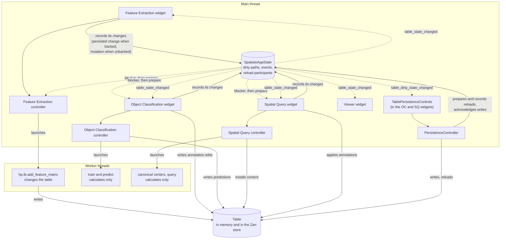

# Table state, persistence and reloads

This document describes how Spatiato keeps an AnnData table consistent across
its widgets, memory and the Zarr store: who changes a table, how a change is
announced, what Write and Reload do, and how running jobs interact with a
reload. It is an internal developer contract, not user documentation.

Not covered here: Shapes elements (their own written and reloaded events),
coordinate-system changes (their own participant protocol), and how Feature
Extraction decides what to calculate
([`feature_extraction.md`](feature_extraction.md)).

## Terms

- **Backed:** `sdata.path` is set, so each table also lives in a Zarr store.
  **Unbacked:** the table exists only in memory. Write and Reload exist only
  for backed SpatialData.
- **Component path** (`TableComponentPath`): an `obs` column, an `obsm` key or
  an `uns` path; the unit Spatiato tracks, writes and reloads. Any `obs` path
  covers the whole `obs` dataframe, an `obsm` path only its key, and an `uns`
  path also everything nested below it.
- **Dirty path:** a component path changed in memory and not yet written. App
  state keeps the dirty paths per SpatialData object and table, each with a
  token that identifies its latest change.
- **Mutation:** a change that exists only in memory. A widget records it with
  `record_table_mutation(event)`, which makes its paths dirty.
- **Persisted change:** a change that is already in the store when it is
  recorded, because harpy wrote it. A widget records it with
  `record_persisted_table_change(event, snapshot)`, which makes none of its
  paths dirty.
- **Dirty snapshot** (`TableDirtySnapshot`): the dirty paths and their tokens
  at one moment. A path that is persisted later becomes clean only if its
  token is still the one in the snapshot, so a newer change stays dirty.
- **Reload:** replacing the in-memory components of one table with the ones in
  the store.
- **Reload participant:** an object that consumes a table and must react
  before it is reloaded.

Signals and calls, as the diagram labels them:

- **Records its changes:** after a widget changes a table, it tells app state
  about it, as a mutation or a persisted change. App state then updates the
  dirty paths and passes the change on to every widget through
  `table_state_changed`. If that makes the table as a whole dirty or clean, it
  also emits `table_dirty_state_changed`. So the widget that made the change
  only talks to app state, and the others only listen to app state. A change
  that is not recorded is never passed on, and never becomes dirty.
- **`table_state_changed`:** app state's signal that something in a table
  changed, for example a column was edited or a feature matrix was written.
  It is emitted for every recorded change, a reload included. It carries a
  `TableStateChangedEvent` that says what changed (the component paths, and
  the regions whose rows changed), how (the change kind) and who changed it
  (the source). Widgets use it to adapt to the new contents.
- **`table_dirty_state_changed`:** app state's signal that a table became
  dirty (it now has unsaved changes) or clean again (it has none left). It
  carries only `is_dirty`, and is emitted only at that moment, not on every
  change. It reflects Spatiato's records, not a comparison with the store: a
  change made outside the widgets, for example from the napari console, is not
  seen. The persistence controls use it for the Write button and the Reload
  warning.
- **Blocker, then prepare:** the two passes app state makes over the
  participants before a reload. First every participant may return a
  **blocker** from `table_reload_blocker()`: the reason the reload must wait.
  Only if none does, every participant's `prepare_for_table_reload()`
  invalidates its work.

## The pieces

| Piece | Where | Responsibility |
|---|---|---|
| `SpatiatoAppState` | [`_app_state.py`](../../src/spatiato/_app_state.py) | One per napari viewer. Keeps the dirty paths, publishes `table_state_changed` (one change, with its component paths) and `table_dirty_state_changed` (a table became dirty or clean), and prepares reloads with its reload participants. |
| `TablePersistenceControls` | [`widgets/persistence/controls.py`](../../src/spatiato/widgets/persistence/controls.py) | The Write and Reload buttons, embedded in the Object Classification and Spatial Query widgets. Asks Write / Discard / Cancel before reloading a dirty table, and shows errors. |
| `PersistenceController` | [`widgets/persistence/controller.py`](../../src/spatiato/widgets/persistence/controller.py) | One per set of controls. Writes the dirty paths, and captures and runs a reload. |
| Table I/O | [`core/persistence.py`](../../src/spatiato/core/persistence.py) | Writes and reads the components of one table in the store. |
| Widgets and their controllers | `widgets/<workflow>/` | Change the table, record each change in app state, and adopt changes made by others. |
| Workers | threads started by the controllers | Calculate. Only a harpy call changes the table from a worker. |

## How they connect

Solid arrows are calls, dotted arrows are signals and callbacks from app
state.

Widgets never call each other: everything they need to know about another
widget's change arrives through app state.

## Changing a table

Every change is recorded in app state by the widget that made it, with a
`TableStateChangedEvent`: the SpatialData object, the table, the component
paths, the regions whose rows changed, a change kind (`created`, `updated`,
`removed`, `rebuilt` or `reloaded`) and a source. How it is recorded depends on
where the change is:

| The change is | Recorded with | Effect on dirty paths | Examples |
|---|---|---|---|
| only in memory | `record_table_mutation(event)` | each path becomes dirty, with a new token | Object Classification's annotation edits, predictions and configuration; Spatial Query's annotations and canonical centers; Feature Extraction on unbacked SpatialData |
| already in the store | `record_persisted_table_change(event, snapshot)` | none becomes dirty; a path that was dirty in the snapshot taken at launch and that harpy wrote becomes clean, unless it changed again since | Feature Extraction on backed SpatialData |

Both publish the event on `table_state_changed`, and, when the table as a whole
becomes dirty or clean, also `table_dirty_state_changed`. Consumers filter on the SpatialData object, the
table, the source and the change kind. For example, Object Classification
refreshes its feature-matrix choices on a `feature_extraction` event, and every
workflow adopts a `reloaded` event. Publishing an event never makes a path
clean by itself.

## Write

1. Write in the persistence controls calls
   `PersistenceController.write_table_state()`.
2. It takes a dirty snapshot and writes exactly those paths to the store, on
   the main thread.
3. `acknowledge_table_write(snapshot, persisted_paths=...)` makes each written
   path clean if its token is still the one in the snapshot.
4. When the table as a whole becomes clean, `table_dirty_state_changed`
   refreshes every set of persistence controls bound to it.

## Reload

1. Reload in the persistence controls first asks Write / Discard / Cancel when
   the table is dirty. Write writes before reloading, Discard reloads over the
   unsaved changes, and Cancel stops.
2. The persistence controller captures a `TableReloadRequest`: the table, and
   every component path in memory or in the store, plus the dirty paths.
3. `app_state.prepare_for_table_reload(request)` runs two passes over one copy
   of the participant list:
   1. every participant's `table_reload_blocker(request)` returns a reason, or
      `None`, without side effects. If any participant gives a reason, app
      state raises `TableReloadBlockedError` with every reason, the controls
      show it, and nothing has changed;
   2. otherwise every participant's `prepare_for_table_reload(request)`
      invalidates its work that depends on the old table.
4. The components are read from the store and replaced in memory. A failure
   while reading or validating restores the previous components.
5. `record_table_reload(event)` makes every reloaded path clean and publishes
   the event with change kind `reloaded`. Each workflow adopts it: it refreshes
   its choices from the reloaded table and binds them again.

A reload replaces the components of one table only.

## Jobs and reloads

What a participant does with a running job depends on where the job's result
ends up in the table:

- **The worker changes the table itself**, in memory or in the store, as a
  harpy call does. It can be neither interrupted nor undone, and a reload
  during it would race with it: the reload could read a half-written store, or
  harpy could install its result in the reloaded table afterwards. The
  participant **blocks** the reload until the job has finished.
- **The worker only calculates**, and the result is written on the main thread
  when it arrives. The participant lets the reload go ahead and **invalidates**
  the job in `prepare_for_table_reload()`. The result, calculated from the
  table being replaced, is discarded and never written to the table.

| Participant | Blocker | Prepare |
|---|---|---|
| Feature Extraction controller | a reason while its job writes the requested table | nothing: when a reload gets here, no job of its own writes that table |
| Object Classification widget | `None` | freezes its classifier work: cancels its jobs and drops its model snapshot |
| Spatial Query widget | `None` | invalidates its Run |

Feature Extraction registers its controller, not its widget, because the
protection has to outlive the widget: a harpy call keeps writing after the
widget closes. On close, the controller stays registered until its job has
finished (`release_reload_participant_when_safe()`). A widget that only
invalidates registers itself and unregisters when it is destroyed.

Because the blockers are all asked before anyone prepares, a blocked reload
changes nothing in any workflow, whatever the order in which they registered.

A new participant implements both methods, compares the request's SpatialData
object (by identity) and table name with its own before acting, keeps
`table_reload_blocker()` free of side effects, and registers with
`register_table_reload_participant()`.

## Where to find it

- App state: `TableStateChangedEvent`, `TableDirtySnapshot`,
  `TableReloadRequest`, `TableReloadParticipant`, `TableReloadBlockedError`,
  `record_table_mutation`, `record_persisted_table_change`,
  `record_table_reload`, `acknowledge_table_write` and
  `prepare_for_table_reload` in
  [`src/spatiato/_app_state.py`](../../src/spatiato/_app_state.py).
- Persistence: `TablePersistenceControls` in
  [`src/spatiato/widgets/persistence/controls.py`](../../src/spatiato/widgets/persistence/controls.py),
  `PersistenceController` in
  [`src/spatiato/widgets/persistence/controller.py`](../../src/spatiato/widgets/persistence/controller.py),
  `write_table_components` and `reload_table_components` in
  [`src/spatiato/core/persistence.py`](../../src/spatiato/core/persistence.py).
- Participants: `table_reload_blocker` and `prepare_for_table_reload` in
  [`widgets/feature_extraction/controller.py`](../../src/spatiato/widgets/feature_extraction/controller.py),
  [`widgets/object_classification/widget.py`](../../src/spatiato/widgets/object_classification/widget.py)
  and
  [`widgets/spatial_query/widget.py`](../../src/spatiato/widgets/spatial_query/widget.py).
